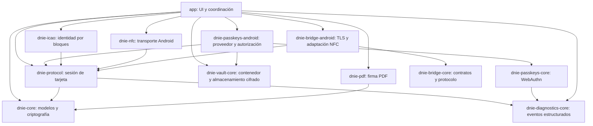

# DNIe Evolucion: organización del fork

Mapa vigente consolidado antes del reinicio: [arquitectura actual 2.0](docs/architecture/ARQUITECTURA_ACTUAL_2_0.md). Estado instalado y pruebas siguientes: [retomar rc4](docs/operations/RETOMAR_TRAS_REINICIO_RC4.md). Las secciones de versiones antiguas de este documento conservan la historia de modularización.

Windows separa ahora la interfaz nativa (`tools/windows-manager`), control/vida del host (`tools/windows-control`), servicio SYSTEM (`tools/windows-agent`) y motor (`tools/windows-bridge`). Uso del ejecutable y permisos: [gestor Windows](tools/windows-manager/README.md).

## Origen y aislamiento

Este repositorio es una copia Git independiente de la versión 1.0.8 funcional. El commit de origen es `0138298e078183a4b729f3f7ca758c3a591d1e9a`, conservado en el tag `dnie-v1.0.8-validated`.

La carpeta original `G:\Mi unidad\BOT TRADER\DNI_CODEX\modest-bose` permanece en la rama `baseline/1.0.8`. Su código y APK no se modifican durante el desarrollo de este fork. El trabajo nuevo se hace aquí, en `refactor/modularizacion`.

El fork tiene identidad Android propia: **DNIe Evolucion**, paquete debug `pe.gob.reniec.dnie.evolution.debug`, versión inicial `1.1.0-dev`. Su keystore de desarrollo es `signing/evolution-development.jks`, excluido de Git. Puede instalarse junto a DNIe Modest Bose sin sustituirlo.

## Módulos y responsabilidades

| Módulo | Plataforma | Contenido | Dependencias internas |
| --- | --- | --- | --- |
| `dnie-core` | Kotlin/JVM, Java 17 | Modelos de certificados/PIN, APDU, PACE criptográfico, X.509, CMS y exportación de certificados. | Ninguna. |
| `dnie-protocol` | Kotlin/JVM, Java 17 | Canal abstracto, transceptor, sesiones v3, Secure Messaging, diagnóstico y logging. | `dnie-core`, `dnie-diagnostics-core`. |
| `dnie-nfc` | Android Library | Adaptador IsoDep y ciclo de vida del lector NFC. | `dnie-protocol`. |
| `dnie-pdf` | Android Library | Firma PAdES, estampado visual y opciones/resultados PDF. | `dnie-core`. |
| `dnie-icao` | Kotlin/JVM, Java 17 | Sesión ICAO independiente, lectura por bloques, MRZ, imágenes, datos adicionales y comprobación de EF.SOD. | `dnie-protocol` (y núcleo transitivo). |
| `dnie-vault-core` | Kotlin/JVM, Java 17 | Contenedor cifrado, metadatos autenticados, almacenamiento de objetos, importación/exportación y prueba de recuperación de claves. | Ninguna interna. |
| `dnie-passkeys-core` | Kotlin/JVM, Java 17 | WebAuthn/ES256, validación de solicitudes y DAL, CBOR/COSE y catálogo privado. | `dnie-diagnostics-core`. |
| `dnie-diagnostics-core` | Kotlin/JVM, Java 17 | Contrato de eventos estructurados y errores sin datos privados. | Ninguna interna. |
| `dnie-passkeys-android` | Android Library | Proveedor Credential Manager, identidad de apps/navegadores, almacén cifrado y autorización DNI. Sin Compose. | `dnie-passkeys-core`, `dnie-vault-core`, `dnie-protocol`. |
| `dnie-bridge-core` | Kotlin/JVM, Java 17 | Contratos y protocolo del puente seguro. | Ninguna interna. |
| `dnie-bridge-android` | Android Library | Emparejamiento JSON/QR, TLS y adaptación del puente NFC. Sin Compose. | `dnie-bridge-core`, `dnie-protocol`. |
| `app` | Android Application | Compose, ViewModels, navegación, casos de uso, repositorios Android y coordinación NFC/PDF. Decodificación Android de JPEG/JPEG2000. | Las bibliotecas funcionales del proyecto. |

La implementación conserva los paquetes Kotlin originales para evitar cambios innecesarios en imports y APIs. La separación es física y de compilación: las bibliotecas JVM no importan clases de Android ni dependen de `app`.



Los módulos se declaran en `settings.gradle.kts` y usan dependencias `project(...)`, siguiendo la [estructura multiproyecto de Gradle](https://docs.gradle.org/current/userguide/multi_project_builds.html).

## Separación de archivos Kotlin

La entrega `1.7.2-maintenance` mueve SAF/PDFBox de importación a `data/signing`, mantiene límites y aceptación en `domain/signing/ImportSigningDocuments`, y prepara un índice de bóveda reutilizable fuera de Main. El mapa de documentos está en [docs/README.md](docs/README.md); [MANTENIMIENTO_1_7_2.md](MANTENIMIENTO_1_7_2.md) recoge el checkpoint y la deuda restante. `python tools/check_architecture.py` comprueba imports y ciclos declarados sin modificar el repositorio.

La versión `1.6.2-persistent-diagnostics` añade un contrato JVM independiente, almacenamiento SQLite asíncrono en `data/diagnostics` y una pantalla privada en `ui/diagnostics`. La captura, sus límites y las instrucciones de exportación están en [DIAGNOSTICO_PERSISTENTE_APP.md](DIAGNOSTICO_PERSISTENTE_APP.md).

En `1.5.1-vault-preview-can`, la política pura `domain/vault/VaultPreviewPolicy` gobierna la disponibilidad del visor y su comprobación posterior. El CAN compartido reside en `data/preferences`, tras el contrato `RememberedCanStore`; ningún almacén de preferencias depende de componentes de UI. Véase [AJUSTE_VISTA_PREVIA_Y_CAN.md](AJUSTE_VISTA_PREVIA_Y_CAN.md).

La versión `1.5.0-vault-tools` añade catálogo/búsqueda/respaldo en el motor JVM, casos de uso de lotes y notas, y adaptadores Android de recepción y vista previa. Los componentes Compose solo presentan estado y acciones. Detalles, formatos, límites y pruebas en [IMPLEMENTACION_BOVEDA_HERRAMIENTAS.md](IMPLEMENTACION_BOVEDA_HERRAMIENTAS.md).

La versión `1.4.5-refactor` separa el almacenamiento Android de la coordinación de pantalla y descompone los archivos visuales de bóveda, consola y certificados. El registro de esta reorganización y las tareas pendientes están en [DEUDA_TECNICA_Y_ORGANIZACION.md](DEUDA_TECNICA_Y_ORGANIZACION.md).

| Capa dentro de `app` | Responsabilidad | Ejemplos |
| --- | --- | --- |
| `data/vault` | Contexto de aplicación, preferencias, certificado público, archivos privados, SAF y dispatcher IO. | `AndroidVaultRepository`, `RestoredDocumentName`. |
| `domain/signing` | Operaciones de firma independientes de los componentes Compose. | Casos de uso de firma y exportación. |
| `ui/<función>` | Estado observable, acciones, coordinación de sesión, pantallas y componentes de la función. | `VaultViewModel`, `VaultScreen`, `VaultComponents`, `ConsoleUiState`, `ApduLogItem`. |
| `diagnostics` | Medición de renderizado para diagnóstico debug. | `UiFrameDiagnostics`. |

Los ViewModels publican estado en el hilo principal. Las operaciones del repositorio de bóveda cambian a IO y serializan el acceso a sus archivos con un mutex. El repositorio no recibe CAN, PIN ni sesiones NFC; el ViewModel conserva la cancelación y cierra la tarjeta. La criptografía y el formato del contenedor siguen en `dnie-vault-core`.

El motor JVM usa el artefacto `tink-android` como dependencia de compilación y pruebas, y `app` aporta ese mismo runtime. No sustituirlo por el artefacto Java de Tink: la mezcla causó una incompatibilidad de Protobuf en Android. El motor no importa APIs Android.

La versión 1.3.0-vault-lab añade `app/ui/vault` y `VaultProbeCard` en protocolo para comprobar descifrado v3 mediante APDU extendida. La coordinación del transporte permanece en `app`; el motor JVM no depende del protocolo. Véase `IMPLEMENTACION_BOVEDA_INICIAL.md` para alcance, pruebas y validación física pendiente.

La firma de documentos incorpora casos de uso independientes en `app/domain/signing`, estado UI separado y un editor de posición PDF. La construcción/verificación CMS pertenece al núcleo; el sello y su geometría pertenecen a `dnie-pdf`. Véase `IMPLEMENTACION_FIRMA_MODERNA.md` para funciones, pruebas y límites de la versión 1.2.0.

- `PaceTypes.kt` reúne los tipos y resultados de PACE; `PaceProtocol.kt` contiene el motor criptográfico.
- `PaceException.kt` contiene el error específico de establecimiento de sesión; `PaceHandler.kt` coordina el handshake.
- `DnieDiagnostics.kt` contiene el sondeo de aplicaciones/directorios. `DnieTransceiver.kt` delega ese trabajo y mantiene la coordinación normal de certificados, PIN y firma.
- `V3PkiSession.kt`, `V3PkiProbe.kt` y `PaceSecureChannel.kt` conservan las responsabilidades ya separadas en la base funcional.

La extracción de diagnóstico conserva el dispatcher, los callbacks de sesión y el acceso al CAN actual. La sesión segura sigue perteneciendo al transceptor; el diagnóstico no crea un segundo contador SSC.

`SigningRequest.kt` permanece en `app` porque incluye opciones de presentación PDF. Los modelos de certificados y PIN permanecen en el núcleo. Los detalles UI no deben introducirse en el protocolo.

## Invariantes de la base funcional

1. IAS en claro → PKI en claro → PACE en ese contexto → PKI protegido.
2. IM ECDH AES-256, curva 13; CAN ASCII de seis dígitos; token de tarjeta obligatorio.
3. Certificados personales CE81/CE82/CE83; EF.SOD no sustituye al certificado del titular.
4. VERIFY v3 referencia 03, relleno FF a 12 bytes; MSE clave 82/algoritmo 42; PSO con hash de 32 bytes.
5. Fragmentos externos `61xx` se reúnen con GET RESPONSE físico antes de verificar y descifrar la envoltura. No incrementar SSC por esa continuación.
6. Mantener validación MAC, estados autenticados, límites de lectura y rechazo de sesiones inconsistentes.

Esta refactorización organiza las responsabilidades y la compilación. No introduce un perfil nuevo de tarjeta ni cambia intencionalmente la secuencia de firma probada.

## Pruebas y compilación

Las pruebas existentes se trasladan al módulo propietario. Los mocks de tarjeta están en las pruebas de `dnie-protocol`. Las fuentes, tablas y recursos PDF se conservan una sola vez en `test-resources/pdfbox`, compartidos por las pruebas de `dnie-pdf` y `app`; no se alteran esos archivos de terceros.

Desde esta carpeta, en PowerShell con JDK 17 y Android SDK:

```powershell
$env:JAVA_HOME = 'C:\Program Files\Microsoft\jdk-17.0.20.101-hotspot'
.\gradlew.bat :dnie-core:test :dnie-protocol:test :dnie-vault-core:test :dnie-icao:test :dnie-pdf:testDebugUnitTest :dnie-passkeys-core:test :dnie-passkeys-android:testDebugUnitTest :app:testDebugUnitTest :app:exportBranchApk :app:compileDebugAndroidTestKotlin --console=plain
```

APK del fork: `app/build/outputs/apk/evolution/dnie-evolution-debug.apk`.

Las pruebas y la compilación comprueban la reorganización. Los flujos posteriores de firma, ICAO y bóveda tienen sus propios registros de validación; eso no sustituye una comprobación física del APK recién refactorizado. Compilar las pruebas instrumentadas tampoco significa ejecutarlas en el teléfono.

### Resultado de la primera refactorización

Compilación debug y exportación APK completadas. Las 120 pruebas originales siguen aprobadas:

| Módulo | Pruebas | Fallos/errores |
| --- | --- | --- |
| `dnie-core` | 41 | 0 |
| `dnie-protocol` | 55 | 0 |
| `dnie-pdf` | 7 | 0 |
| `app` | 17 | 0 |

Al cruzar límites de módulos, Kotlin exigió capturar `CommandApdu.le` y `ApduLogEntry.statusWordHex` en variables locales para comprobar su nulabilidad. Esos dos ajustes conservan los mismos valores y comportamiento.

Se compararon los fuentes Kotlin con la base ignorando diferencias de finales de línea: los cambios de contenido se limitan a la extracción de tipos PACE, la extracción del diagnóstico, la separación de `PaceException` y los dos ajustes de nulabilidad anteriores. Los restantes fuentes movidos conservan su contenido.

El HEAD de la base permanece en `0138298e078183a4b729f3f7ca758c3a591d1e9a`. Sus dos copias de APK siguen teniendo SHA-256 `B5E3754E409A5BED57E01A4810C7FC5F1D0E1597E44C8B1E3E0D4E21A571BA94`. Además se conservó `G:\Mi unidad\BOT TRADER\DNI_CODEX\analysis\validated-1.0.8\source-baseline.bundle`, verificado como copia Git con historia completa de la rama/tag de referencia.

## Desarrollo posterior

La primera función nueva del fork es ICAO, versión `1.1.1-icao-dev` (código 11). Su diseño, datos soportados, validación y pendientes están en [IMPLEMENTACION_ICAO.md](IMPLEMENTACION_ICAO.md). Las invariantes IAS/PKI anteriores se aplican al flujo de certificados y firma; ICAO abre una sesión separada desde una nueva aproximación NFC.

- Añadir pruebas del comportamiento nuevo en su módulo propietario y mantener las regresiones del protocolo.
- Introducir perfiles adicionales en el protocolo, sin mezclar sus comandos con v3 ni con la interfaz.
- Mantener Android NFC detrás de `DnieCardChannel`; evitar dependencias Android en las bibliotecas JVM.
- Continuar reduciendo el transceptor por responsabilidades si se añaden nuevos perfiles o flujos. La separación de módulos no implica que toda la deuda técnica de la base esté resuelta.
- Registrar cada avance en commits de este repositorio; no avanzar el tag o la rama de la base clausurada.
