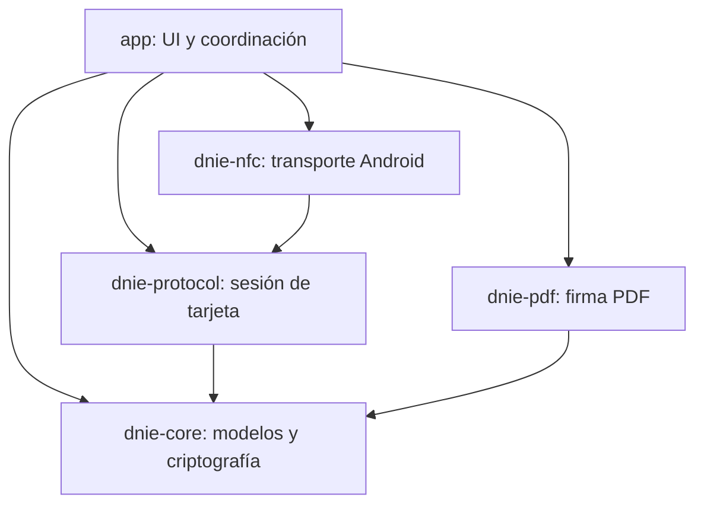

# DNIe Evolucion: organización del fork

## Origen y aislamiento

Este repositorio es una copia Git independiente de la versión 1.0.8 funcional. El commit de origen es `0138298e078183a4b729f3f7ca758c3a591d1e9a`, conservado en el tag `dnie-v1.0.8-validated`.

La carpeta original `G:\Mi unidad\BOT TRADER\DNI_CODEX\modest-bose` permanece en la rama `baseline/1.0.8`. Su código y APK no se modifican durante el desarrollo de este fork. El trabajo nuevo se hace aquí, en `refactor/modularizacion`.

El fork tiene identidad Android propia: **DNIe Evolucion**, paquete debug `pe.gob.reniec.dnie.evolution.debug`, versión inicial `1.1.0-dev`. Su keystore de desarrollo es `signing/evolution-development.jks`, excluido de Git. Puede instalarse junto a DNIe Modest Bose sin sustituirlo.

## Módulos y responsabilidades

| Módulo | Plataforma | Contenido | Dependencias internas |
| --- | --- | --- | --- |
| `dnie-core` | Kotlin/JVM, Java 17 | Modelos de certificados/PIN, APDU, PACE criptográfico, X.509, CMS y exportación de certificados. | Ninguna. |
| `dnie-protocol` | Kotlin/JVM, Java 17 | Canal abstracto, transceptor, sesiones v3, Secure Messaging, diagnóstico y logging. | `dnie-core`. |
| `dnie-nfc` | Android Library | Adaptador IsoDep y ciclo de vida del lector NFC. | `dnie-protocol`. |
| `dnie-pdf` | Android Library | Firma PAdES, estampado visual y opciones/resultados PDF. | `dnie-core`. |
| `app` | Android Application | Compose, ViewModels, navegación, casos de uso y coordinación NFC/PDF. | Las cuatro bibliotecas. |

La implementación conserva los paquetes Kotlin originales para evitar cambios innecesarios en imports y APIs. La separación es física y de compilación: las bibliotecas JVM no importan clases de Android ni dependen de `app`.



Los módulos se declaran en `settings.gradle.kts` y usan dependencias `project(...)`, siguiendo la [estructura multiproyecto de Gradle](https://docs.gradle.org/current/userguide/multi_project_builds.html).

## Separación de archivos Kotlin

- `PaceTypes.kt` reúne los tipos y resultados de PACE; `PaceProtocol.kt` contiene el motor criptográfico.
- `PaceException.kt` contiene el error específico de establecimiento de sesión; `PaceHandler.kt` coordina el handshake.
- `DnieDiagnostics.kt` contiene el sondeo de aplicaciones/directorios. `DnieTransceiver.kt` delega ese trabajo y mantiene la coordinación normal de certificados, PIN y firma.
- `V3PkiSession.kt`, `V3PkiProbe.kt` y `PaceSecureChannel.kt` conservan las responsabilidades ya separadas en la base funcional.

La extracción de diagnóstico conserva el dispatcher, los callbacks de sesión y el acceso al CAN actual. La sesión segura sigue perteneciendo al transceptor; el diagnóstico no crea un segundo contador SSC.

`SigningRequest.kt` permanece en `app` porque incluye opciones de presentación PDF. Los modelos de certificados y PIN permanecen en el núcleo. Los detalles UI no deben introducirse en el protocolo.

## Invariantes de la base funcional

1. IAS en claro → PKI en claro → PACE en ese contexto → PKI protegido.
2. IM ECDH AES-256, curva 13; CAN ASCII de seis dígitos; token de tarjeta obligatorio.
3. Certificados personales CE81/CE82/CE83; EF.SOD no sustituye al certificado del titular.
4. VERIFY v3 referencia 03, relleno FF a 12 bytes; MSE clave 82/algoritmo 42; PSO con hash de 32 bytes.
5. Fragmentos externos `61xx` se reúnen con GET RESPONSE físico antes de verificar y descifrar la envoltura. No incrementar SSC por esa continuación.
6. Mantener validación MAC, estados autenticados, límites de lectura y rechazo de sesiones inconsistentes.

Esta refactorización organiza las responsabilidades y la compilación. No introduce un perfil nuevo de tarjeta ni cambia intencionalmente la secuencia de firma probada.

## Pruebas y compilación

Las pruebas existentes se trasladan al módulo propietario. Los mocks de tarjeta están en las pruebas de `dnie-protocol`. Las fuentes, tablas y recursos PDF se conservan una sola vez en `test-resources/pdfbox`, compartidos por las pruebas de `dnie-pdf` y `app`; no se alteran esos archivos de terceros.

Desde esta carpeta, en PowerShell con JDK 17 y Android SDK:

```powershell
$env:JAVA_HOME = 'C:\Program Files\Microsoft\jdk-17.0.20.101-hotspot'
.\gradlew.bat :dnie-core:test :dnie-protocol:test :dnie-pdf:testDebugUnitTest :app:testDebugUnitTest :app:exportBranchApk --console=plain
```

APK del fork: `app/build/outputs/apk/evolution/dnie-evolution-debug.apk`.

Las pruebas y la compilación comprueban la reorganización; la prueba NFC y del PDF de la 1.0.8 pertenece a la base. Antes de dar este APK refactorizado por validado en hardware, debe repetirse una firma real y su verificación externa.

### Resultado de la primera refactorización

Compilación debug y exportación APK completadas. Las 120 pruebas originales siguen aprobadas:

| Módulo | Pruebas | Fallos/errores |
| --- | --- | --- |
| `dnie-core` | 41 | 0 |
| `dnie-protocol` | 55 | 0 |
| `dnie-pdf` | 7 | 0 |
| `app` | 17 | 0 |

Al cruzar límites de módulos, Kotlin exigió capturar `CommandApdu.le` y `ApduLogEntry.statusWordHex` en variables locales para comprobar su nulabilidad. Esos dos ajustes conservan los mismos valores y comportamiento.

Se compararon los fuentes Kotlin con la base ignorando diferencias de finales de línea: los cambios de contenido se limitan a la extracción de tipos PACE, la extracción del diagnóstico, la separación de `PaceException` y los dos ajustes de nulabilidad anteriores. Los restantes fuentes movidos conservan su contenido.

El HEAD de la base permanece en `0138298e078183a4b729f3f7ca758c3a591d1e9a`. Sus dos copias de APK siguen teniendo SHA-256 `B5E3754E409A5BED57E01A4810C7FC5F1D0E1597E44C8B1E3E0D4E21A571BA94`. Además se conservó `G:\Mi unidad\BOT TRADER\DNI_CODEX\analysis\validated-1.0.8\source-baseline.bundle`, verificado como copia Git con historia completa de la rama/tag de referencia.

## Desarrollo posterior

- Añadir pruebas del comportamiento nuevo en su módulo propietario y mantener las regresiones del protocolo.
- Introducir perfiles adicionales en el protocolo, sin mezclar sus comandos con v3 ni con la interfaz.
- Mantener Android NFC detrás de `DnieCardChannel`; evitar dependencias Android en las bibliotecas JVM.
- Continuar reduciendo el transceptor por responsabilidades si se añaden nuevos perfiles o flujos. La separación de módulos no implica que toda la deuda técnica de la base esté resuelta.
- Registrar cada avance en commits de este repositorio; no avanzar el tag o la rama de la base clausurada.
