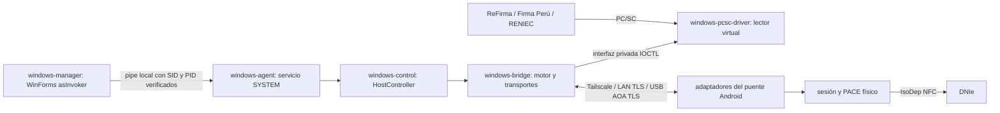

# Arquitectura actual · motor 2.0 y gestor Windows rc4

2026-10-15 · R10 / Android 3.1.3 (APK 87) instalada por ADB sin borrar datos, misma firma y auxiliar compatible. Selector segmentado compartido, Bento/credencial/guía refinados, CAN compacto y PC vinculada con acciones fijas. Suite incorpora diálogo PIN propio y hover finito; Bridge mejora cabecera y tarjetas de salud. 254 pruebas JVM aprobadas, 1 omisión preexistente, 52 comprobaciones Manager y 14 instrumentadas Android aprobadas. Comparación puntual de cuadros por VSYNC: P95 8,88→8,94 ms; no garantiza 60 FPS constantes. Motores, servicio y controlador sin cambios. Pendientes pruebas físicas NFC/TSA/USB/suspensión y documentos representativos. Ver `docs/design/ACABADO_FLUIDEZ_R10.md` y `docs/operations/ACABADO_R10_RESULTADOS.json`. Los párrafos siguientes conservan historial.

2026-10-15 · R9 / Android3.1.2 (APK86) instalada por ADB sin borrar datos y con firma compatible; auxiliar actualizado con la misma firma. DESIGN.md, paleta compartida claro/oscuro, categorías sans y números tabulares; radar NFC/resortes con movimiento reducido y guía optativa CAN/NFC/móvil-PC. Suite/gestor Windows compilados y accesos actualizados. 252 pruebas JVM pasan/1 omitida preexistente,48 comprobaciones Manager y8 instrumentadas Android pasan. Motores, servicio y driver sin cambios. NFC/TSA/háptica físicos y regresión USB/suspensión pendientes. Ver `docs/design/SISTEMA_DISENO_GUIA_R9.md` y `docs/operations/DISENO_R9_RESULTADOS.json`. Los párrafos siguientes conservan historial.

2026-10-14 · Android 3.1.1 / APK85 instalada por ADB, sin desinstalar ni borrar datos. Usuario confirmó APK84 y reactivó ADB. Versionado central en gradle.properties y comando para incrementar patch/código por entrega; Configuración muestra versión. Firma app/auxiliar idéntica y compatible con84; ambos instalados. 89 unitarias pasan/1 omitida y4 instrumentadas R8 pasan (9,22s), sin DNI. Auxiliar queda instalado con identidad estable. NFC/TSA/háptica físicos siguen pendientes; Windows instalado conserva R8. [Detalle](../operations/VERSIONADO_Y_FIRMA_3_1_1.md). Los avisos de ADB suspendido siguientes son históricos y están revocados por el usuario.

2026-10-14 · Pantallas y NFC R8 / APK84 (3.1.0) compilada debug/release, sin instalar ni usar ADB; APK82 sigue siendo la última instalada. Hoja continua credenciales→NFC→progreso→resultado; CAN compacto y PIN transitorio. Firma con preview superior, tres pestañas y barra fija, resultados parciales explícitos. Cinco destinos comunes; Mi DNIe agrupa visualmente Certificados/Identidad, credencial ICAO y detalles plegables. Suite Windows con plantillas 2×2, indicador de actividad y apertura del PDF real. 251 JVM pasan/1 omitida y Manager44 pasan; auxiliar Android compilado, sin ejecutar. Suite preparada y acceso actualizado; Bridge/servicio/driver y motores criptográficos sin cambios. Pruebas Android/NFC pendientes. [R8](../design/PANTALLAS_FLUJOS_NFC_R8.md).

2026-10-14 · Personalización R7 / APK83 (3.1.0) compilada debug/release; no instalada: ADB suspendido hasta nuevo aviso del usuario. APK82 sigue siendo la última instalada. Sello con fondo transparente, insignias check/candado, fecha/densidad/colores, plantillas y esquinas al6%; diseño Android persistente, navegación y acciones Mi DNIe. Respuesta táctil por eventos NFC con ajuste de usuario. Windows añade PNG de rúbrica, DnD visual y tema claro/oscuro. 241 JVM pasan/1 omitida por permisos Windows y 44 comprobaciones Manager pasan. Interfaces Windows y accesos actualizados; servicio, driver, identidad y motores criptográficos conservados. Pruebas Android y firma física R7 pendientes. [R7](../design/PERSONALIZACION_SELLO_HAPTICA_R7.md).

2026-10-14 · Red R6 / APK82 (3.1.0) instalada: Bridge Red (Wi-Fi/Tailscale) + USB; descubrimiento autenticado y TLS fijado por huella/token, IP opcional en Suite/gestor y CLI. Vista previa Android muestra anotaciones existentes. QR de sello/cotejador retirados de UI; QR de emparejamiento conservado. 283 pruebas JVM pasan, 3 optativas/privilegios omitidas; 261 Bridge + 48 Control + 41 Manager + 3 servicio instalado pasan; 8 instrumentadas Android pasan. Descubrimiento Windows→Android verificado por LAN y Tailscale por separado, credenciales sintéticas, sin DNI. Gestor/servicio/Suite actualizados, identidad conservada y driver sin reinstalar. Firma NFC y cambio físico de red pendientes. [Rutas, pruebas y límites](RED_COORDINADA_R6.md).

2026-10-14 · Extensión QR R5: formato/cotejo puro en dnie-signing-core/StampQrCodec; metadata derivada en adaptadores PDF Android/Desktop, no en UI. Cámara/SAF en app/data/qr y presentación/coordinación en app/ui/verification. Reutiliza CertificateValidationPanel y validación existente; no modifica CMS/PACE/driver. Ver [QR_COTEJO_R5](../design/QR_COTEJO_R5.md).

2026-10-14 · Presentación Aether: contrato/escena/placement puros en signing-core; adaptadores PDF Android/Desktop, bitmap IO Android y previews Swing asíncronos. Interfaces Suite/Manager actualizadas; autorización, criptografía, transportes y driver preservados. [Mapa y verificaciones](../design/RESULTADO_AETHER_R2.md).

2026-10-13 · Controlador R2 2.0.0.4/oem239 y backend Windows instalados sin reinicio. Errores locales de transmisión ya no retiran la tarjeta; protocolo tras apagado y cancelación antes de entrega corregidos. Pulsos 2 s/operaciones 25 s frente a plazo del driver 30 s. 7860 comprobaciones C++, 137 backend, 31 PCSC nativas y 13 TLSrelay pasan. PnP0 y ReaderPublished=true al finalizar, sin tarjeta. Firma DNI y suspensión físicas pendientes; Android78 no cambia. [Detalle](CONTROLADOR_COMPLETADOS_Y_PROTOCOLO_R2.md).

2026-10-13 · Versión 3.1.0 / APK78 instalada: integración v4 de autenticación resistente, plazos por candidato, integridad SHA-256 de originales/resultados, migración de identidad Windows protegida y DPAPI acotado. Servicio/gestor Windows y Suite actualizados; identidad conservada según metadatos. 177 JVM, 134 comprobaciones Windows y 3 pruebas Android pasan; debug/release compilados y producción comprobada. Firma y USB/NFC físicos nuevos pendientes. [Detalle](SEGURIDAD_BACKEND_3_1_V4.md).

2026-10-09 · Conexiones R5: APK77 / 3.0.0-alpha05-mobility instalada sin borrar datos. Suite y Bridge Wi-Fi ya no fijan identidad a la IP; TLS y token siguen obligatorios. Windows conserva la identidad DPAPI al cambiar IP. TLS directo permite editar destino; Suite tiene pantalla completa independiente y limpia conexión al finalizar lote único. 159 JVM pasan / 3 omitidas, release compilado y 3 pruebas instrumentadas de Suite/Bridge pasan en el móvil. Cambio físico de IP con DNI pendiente. [Detalle](CONEXIONES_DIRECCION_E_IDENTIDAD_R5.md).

2026-10-09 · Controlador R1: driver2.0.0.3 oem237 instalado, PnP0 y PCSC publicado. Retiro EvtIoStop sin replay, cancelación invalida backend, purge síncrono y host UMDF aislado. Servicio/gestor distinguen ReaderPublished del CardPresent privado. 6797 comprobaciones C++ pasan, 25 PCSC nativas y 13 TLSrelay pasan; Control45 Debug/45 Release. Firma física/suspensión reales pendientes; APK76 intacta. [Detalle](CONTROLADOR_ENERGIA_Y_PUBLICACION_R1.md).

2026-10-09 · Conexiones R4: APK76 / 3.0.0-alpha04-links instalada. Puente autentica PC antes de esperar DNI; Suite tiene pantalla completa con presencia separada y diagnóstico de conexión. Red agrupa Wi-Fi/Tailscale, USB separado. Windows host actualizado y GUI Suite selecciona IP vigente; emparejamiento anterior puede requerir TXT/QR actualizado de la misma PC. 154 JVM pasan, 3 omitidas; 93 comprobaciones Windows y 34 Android pasan. Prueba física bilateral y detección de cierre remoto antes de NFC pendientes. [Detalle](CONEXIONES_INDEPENDIENTES_R4.md).

2026-10-09 · Rediseño Android R3: APK75 / 3.0.0-alpha03-sessions instalada. Disposición compacta basada en Aether, estados con comprobaciones y detalles técnicos desplegables. Puente Tailscale/Wi-Fi/USB con pantalla completa PC–teléfono–DNI y único botón Detener sesión. Vibración común; pulso de 90 ms ejecutado por el sistema verificado. 79 JVM pasan, uno omitido; 33 Android pasan. Sesión física y percepción al leer DNI pendientes. [Detalle](REDISENO_ANDROID_3_0_R3.md).

2026-10-08 · Rediseño Android R1: APK73 / 3.0.0-alpha01-interface instalada. Inicio, navegación de cinco secciones, acceso diferenciado Bridge/Suite y tema Aether adaptados a funciones reales. Cierre inicial de navegación corregido (lista lazy); 77 pruebas JVM pasan, una omitida y 28 Android pasan. Interiores y medición de rendimiento pendientes. [Detalle](REDISENO_ANDROID_3_0_R1.md).

2026-10-08 · Diagnóstico R1: APK72 / 2.0.0-rc24-diagnostics instalada. Extracción directa ADB debug sin exportación manual; metadatos de hilo/proceso/capa y spans. 26 pruebas Android pasan; endpoint revalidado y tres lecturas con proceso cerrado pasan. CAN asíncrono, transacciones por lotes y protección de captura incompleta. Cuadros lentos instrumentados siguen pendientes de atribución. [Detalle](DIAGNOSTICOS_DIRECTOS_Y_CAPAS_R1.md).

2026-10-08 · Retiro R3: passkeys eliminadas. APK71 / 2.0.0-rc23-core-only instalada por ADB. Limpieza automática al primer arranque verificada: catálogo y aliases ausentes, proveedor no registrado. 165 pruebas JVM y 5 Android pasan; un caso Windows omitido por permisos se verifica en Android. Bóveda y emparejamientos fuera del alcance de borrado. [Detalle](RETIRO_PASSKEYS_R3.md).

2026-10-08 · Bóveda R7: corregido inicio tras SAF: selector primero, credenciales después y autorización explícita. onPause limpiaba PIN y R6 rechazaba el inicio automático, dejando destino vacío. APK69 instalada por ADB y versión comprobada; 79 pruebas app pasan y 3 pruebas instrumentadas de interfaz pasan (8,537 s). El selector se simula con registro aislado; exportación/importación con SAF real y DNI físico pendientes. [Detalle](BOVEDA_SELECTOR_Y_AUTORIZACION_R7.md).

2026-10-08 · Bóveda R6: APK68 instalada; biblioteca única con Cifrar/Descifrar/Importar/Exportar. Respaldo autosuficiente DNIEBKP2 comprimido y cifrado por contraseña. Importar verifica DNI destino y recifra todo, actualiza UUID coincidentes sin duplicarlos, conserva archivos ajenos y usa journal durable. 137 pruebas JVM y 4 instrumentadas Android pasan; NFC/SAF reales y cruce Windows pendientes. [Detalle](BOVEDA_RESPALDO_UNIFICADO_R6.md).

2026-10-08 · Bóveda R5: APK67 instalada. Mis archivos/Protección/Copias; protección y recuperación de toda la bóveda (incluida papelera), PIN introducido una vez, ZIP recuperado verificado antes de publicar. 79 pruebas app + 23 motor sin fallos; dos pruebas instrumentadas de recuperación pasan. Prueba visual superada en teléfono desbloqueado (1 test, 2.096 s). Recifrado con DNI nuevo manual y lote NFC/SAF real pendientes. [Detalle](RECUPERACION_COMPLETA_Y_FLUJO_R5.md).

2026-10-07 · Bóveda UI R4: APK66 instalado; Archivos/DNI/Recuperar/Más separados, tarjetas compactas, selección múltiple para organizar/papelera/restaurar. 76 pruebas JVM sin fallos y 1 prueba visual en teléfono superada; motor/PACE intactos. [Detalle](BOVEDA_UI_SIMPLE_R4.md).

2026-10-07 · Recuperación Android R3: APK65 instalado por ADB; motor aislado + adapter IO/SAF + UI. Paquete por archivo preparado con DNI original, recuperación con paquete y contraseña. 125 resultados JVM sin fallos; APK principal/auxiliar compilados. Auxiliar instalado al reintentar; 1 prueba instrumentada sintética superada en teléfono (4.708 s). Flujo real CIF/SAF y cruces pendientes. [Detalle](RECUPERACION_ANDROID_R3.md).

2026-10-07 · P0 conceptual de bóveda/passkeys: renovación puede sustituir la privada aun en el mismo chip. Respaldos actuales siguen ligados a la clave anterior y no recuperan tras su eliminación; migración actual exige abrir con clave vieja y nueva después. Recuperación independiente/asistente previo todavía sin implementar ni activar. [Auditoría y alternativas](RECUPERACION_Y_RENOVACION_DNI.md).

2026-10-07 · H15: CMS compartido incluye issuerSerial exacto en ESSCertIDv2 para compatibilidad con política PE de ReFirma PCX. Sin cambios de UI, PACE o transporte; 247 pruebas y comparación sintética con DSS real satisfactorias. Validación física externa pendiente. Ver docs/suite/REFIRMA_ISSUER_SERIAL_H15.md.

2026-10-07 · H12 físico superado desde Windows: usuario aporta Firma Perú VÁLIDO para acta PDF PAdES_BASELINE_T (raíces firmante/TSA en TSL Sí, TSA RENIEC TSU-2026-01 21:08:57 UTC-05) y TXT/.p7s CAdES_BASELINE_B válido sin TSA. Falta resultado del segundo PDF, confirmación 3/3/PIN único y cambio Bridge↔Suite. [Evidencia y alcance](../suite/TSA_RENIEC_WINDOWS_H12.md).

2026-10-07 · H13: integración inicial Suite + Bridge con módulo JVM de coordinación y adaptador .NET opcional al servicio autenticado. GUI integra estado, abrir gestor y detener puente; permiso local evita cambiar de modo durante suite, sin exclusión global entre procesos. 43 pruebas y smoke real de consulta pasan, APK63 recompilado sin cambio. Paquete en D:/DNIeToolchain/Builds/suite-bridge-h13; configuración Bridge conserva ventana nativa y ambas distribuciones autónomas. [Capas, distribución y pendientes](../suite/INTEGRACION_BRIDGE_MODULAR_H13.md).

2026-10-07 · H12 Windows: TSA RENIEC opcional integrada en PDF visible/invisible de GUI y consola (--pdf-tsa reniec), reutilizando el motor Android verificado. 76 pruebas pasan y ejecutable distribuido produce PDF sintético con TSA real verificado. Distribuciones nuevas en D:/DNIeToolchain/Builds/tsa-reniec-h12; APK63 no cambia. Pendiente firma Windows con DNI real y validación externa. [Arquitectura, uso y prueba](../suite/TSA_RENIEC_WINDOWS_H12.md).

2026-10-07 · H11 Android: sello RENIEC opcional/obligatorio al activar en PDF integrado, módulo JVM RFC3161 y confianza ROOT5/CRL/TSL; sin repetir operación privada ni publicar B silenciosamente ante fallo. Prueba real del motor con TSA TRUSTED/GOOD y 254 pruebas pasan; APK63 compilado, físico pendiente. Checkpoint previo preservado. [Arquitectura, uso y límites](../suite/ANDROID_TSA_RENIEC_H11.md).

2026-10-07 · H9b físico superado: usuario confirma APK62 con vigencia/uso aptos, titular GOOD por OCSP firmado/vigente, ambas CA intermedias GOOD por CRL vigente/firmada y ruta PKIX verificada con TSL Perú autenticada secuencia25. Vigencia agregada hasta 2026-10-07 17:33:45 UTC-05, limitada por OCSP; requiere nueva consulta al caducar. La causa del UNKNOWN anterior no quedó demostrada. Preflight automático, histórico y TSA pendientes. [Evidencia y límites](../suite/REVOCACION_CA_DIAGNOSTICO_H9B.md).

2026-10-07 · H9b: usuario confirma APK61 con TSL autenticada y ruta PKIX verificada; titular GOOD, revocación global UNKNOWN. CRL de ambas CA verificadas en PC; causa del fallo en móvil aún sin determinar. Motor extraído por CA con resultado/método/código seguro, panel y registro por CA, distinción de evidencia caducada durante consulta. 236 pruebas pasan; APK62 compilado, prueba física pendiente. [Detalle](../suite/REVOCACION_CA_DIAGNOSTICO_H9B.md).

2026-10-07 · H9a: APK60 físico reporta TSL indeterminada. Reproducida dependencia DatatypeFactory/Xerces ausente con runtime XML Android14; reemplazo por lector estricto de fechas y diagnóstico por etapa. 233 pruebas/Debug pasan, APK61 compilado. DOM Android + BC verifican TSL y ruta; teléfono pendiente. No se relaja confianza ni se declara TSA. [Detalle](../suite/TSL_ANDROID_COMPATIBILIDAD_H9A.md).

2026-10-07 · H9: TSL Perú autenticada con ancla AAC independiente, firmante autorizado y CRL; ruta PKIX completa y revocación de CA intermedias. Prueba real JVM TRUSTED/GOOD, 229 pruebas. Android APK60 con panel y rollback persistido; prueba física pendiente. Consulta manual, preflight automático/histórico/TSA pendientes. Usuario confirma H8 en teléfono. [Detalle y límites](../suite/CONFIANZA_TSL_CADENA_H9.md).

2026-10-07 · H8: módulo JVM dnie-validation-core, control local previo a CMS, consulta Android manual OCSP/CRL y rechazo de revocación conocida. 215 pruebas pasan y OCSP real firmado devuelve GOOD con confianza UNKNOWN. APK 59 compilado; UI física pendiente. Confianza TSL, cadena completa y preflight online automático siguen pendientes. [Arquitectura, límites y rutas](../suite/VALIDACION_CERTIFICADOS_H8.md).

2026-10-07 · H7: usuario confirma PDF Android 58 VÁLIDO y PAdES_BASELINE_B. Perfil DER sin signingTime y /M UTC trasladado a PDF desktop; 104 pruebas y demo sintético .NET pasan. GUI/CLI nuevas en D:/DNIeToolchain/Builds/pades-baseline-b, distribuciones anteriores preservadas. Pendiente clasificación externa de PDF Windows con DNI, revocación/TSL integradas y TSA. [Estado y rutas](../suite/PADES_BASELINE_DESKTOP_H7.md).

2026-10-07 · H5: GUI aislada `dnie-signing-ui`, preview/selector y firma privada sin consola; APK 57 implementa escaneo combinado certificados→ICAO con sesiones independientes y cancelación que conserva completos. 265 pruebas pasan. GUI inspeccionada sin DNI; firma GUI pendiente. APK 57 instalado por ADB y versión verificada el 2026-10-07; usuario confirma que funciona el escaneo unificado, sin desglose de bloques ni prueba de cancelación. DNI Bridge/inspección pública Windows son próximos adaptadores, no funciones ya integradas. [Contexto, rutas y límites](../suite/INTERFAZ_AISLADA_Y_ESCANEO_UNIFICADO_H5.md).

2026-10-07 · H4: sello visible de escritorio modular implementado, page/box/fields/style por argumentos y apariencia del campo firmada incrementalmente. Pruebas sintéticas de giros/recortes, firmas sucesivas y render pasan; falta sello físico con DNI. H3 cierre confirmado manual Ctrl+C. [Uso y límites](../suite/PDF_VISIBLE_H4.md).

2026-10-07 · H3: PDF integrado invisible de escritorio implementado en módulo JVM `dnie-pdf-desktop` (PDFBox 3.0.8). Por defecto PDF → `_firmado.pdf`, otros → `.p7s`; `--pdf-mode detached` conserva el modo anterior. Simulación del ejecutable verificada independientemente .NET; prueba física con DNI pendiente. APK instalado 56 y transporte/motor NFC sin cambios funcionales. [Arquitectura, límites y procedimiento](../suite/PDF_INVISIBLE_H3.md).

Actualizado antes del reinicio, 2026-10-06. Este mapa describe la implementación existente; los trabajos no terminados están en [pendientes](../PENDIENTES_ACTUALES.md). La distribución 2.0 final aún requiere regresión física y resolver los pendientes de transporte/distribución.

## Separación de responsabilidades

La UI presenta estado y emite acciones. ViewModels y controladores coordinan casos de uso, exclusión mutua y cancelación. Adaptadores contienen APIs del sistema y almacenamiento. El motor posee protocolos, formatos y criptografía. Los motores no importan Compose/WinForms ni reciben ViewModels para ejecutar operaciones.

| Módulo | Responsabilidad | Dependencias internas de producción |
| --- | --- | --- |
| `dnie-core` | APDU, modelos, criptografía y certificados | Ninguna |
| `dnie-diagnostics-core` | Contrato de eventos estructurados sin datos privados | Ninguna |
| `dnie-protocol` | Sesiones DNI v3, IAS/PKI, PACE físico, SM, traducción de PACE PC | core, diagnostics-core |
| `dnie-nfc` | IsoDep y adaptación Android NFC | protocol |
| `dnie-icao` | Sesión ICAO independiente y lectura por bloques | protocol |
| `dnie-pdf` | Motor PDF/PAdES y sello visual Android | core, signing-core |
| `dnie-signing-core` | Contratos PDF, documentos/resultados y motor de lotes JVM; autorización limitada a una conexión | protocol, diagnostics-core |
| `dnie-signing-desktop` | CLI JVM, workspace/adaptadores locales y simulación explícita de suite (hito 0) | signing-core, signing-link |
| `dnie-signing-link` | Contrato privado de firma, endpoint con autorización/PIN móvil, cliente y framing de flujos; todavía sin transporte físico de suite | protocol |
| `dnie-vault-core` | Contenedor, catálogo y formatos cifrados de bóveda | Ninguna interna |
| `dnie-bridge-core` | Contratos/framing del puente y método de conexión | Ninguna interna |
| `dnie-bridge-android` | Sesión del puente y adaptación del traductor; acceso al contrato privado de suite todavía sin enlace físico | bridge-core, protocol, signing-link |
| `app` | Compose, ViewModels, casos de uso y adaptadores Android | Bibliotecas anteriores según función |

La tabla se contrastó con `settings.gradle.kts` y las dependencias `project(...)`. Los detalles de archivos de funcionalidades anteriores permanecen en [arquitectura del fork](../../ARQUITECTURA_FORK.md).

Actualización 2026-10-07: `dnie-pdf` depende también de `dnie-signing-core`, que aloja los contratos neutrales extraídos del módulo Android. `app` consume ambos y conserva `SigningWorkspace`/SAF/UI. Implementación y prueba pendiente del lote real: [motor de firma rc5](MOTOR_FIRMA_LOTES_RC5.md).

## Motor del DNI y del puente

| Responsabilidad | Entrada principal |
| --- | --- |
| Selección y firma DNI | `dnie-protocol`: V3PkiSession, DnieTransceiver |
| PACE físico / SM NFC | PaceHandler, PaceSecureChannel, PaceBridgeChannel |
| PACE del consumidor PC | PaceTranslationEndpoint, TerminalSecureMessaging, PcPaceNegotiator |
| Fragmentación / respuestas PC | PcResponseFragments |
| Consulta pública de certificados | PlainCertificateReadRoute |
| Consulta vacía de estado PIN | PlainPinStatusQuery |
| Sesión / reconexión Android | `dnie-bridge-android`: BridgeConnection, RestartablePaceCard, TranslatedPaceCard |
| Enlace / permiso / perfiles | `app/data/bridge`: BridgeTransportAdapter, TrustedPcStorage; adaptador de permiso USB |
| Coordinación visual | `app/ui/bridge`: BridgeViewModel y componentes de pantalla |

Invariantes: mantener IAS → PKI → PACE → PKI protegido. Las claves y SSC del PACE físico y del PACE emulado para PC son independientes. GET RESPONSE físico ocurre antes de desenvolver la respuesta protegida; fragmentos del PC se gestionan por separado. Reset/cierre elimina el estado correspondiente; una APDU protegida obsoleta no autoriza reutilizar claves o SSC. Integridad inválida y pérdida del transporte invalidan la sesión. Nunca repetir PIN, firmas ni APDU anteriores tras reconectar.

ICAO abre una conexión y sesión propias. Los bloques ausentes no impiden recuperar los completos; pérdida de transporte/integridad detiene esa sesión. EF.SOD contiene material del emisor, no el certificado de firma personal.

## Extremo Windows

Decisión 2026-10-07: el esquema siguiente describe **el puente compatible existente**, no la futura suite documental. La suite usa `dnie-signing-desktop → dnie-signing-link → transporte privado autenticado → endpoint Android → transceptor/PACE → DNI`, sin PC/SC ni servicio SYSTEM. H1a implementa motores/framing y pruebas simuladas; faltan autenticador, integración física y aprobación UI. Los originales y CMS permanecen en PC; PIN/CAN en Android. Detalle en [contexto de suite](../suite/CONTEXTO_SUITE_FIRMA.md).

| Componente | Posee | No posee |
| --- | --- | --- |
| windows-manager | UI, preferencias públicas, QR en memoria, entrada del instalador y selector opcional | Claves PACE/SSC, procesamiento APDU, controlador PC/SC |
| windows-control | Contratos acotados, autenticación local, SCM específico del servicio, vida del host y adaptación al motor | UI y shell administrativo genérico |
| windows-agent | ServiceMain, cancelación SCM, inscripción del propietario y ejecución SYSTEM | Ventanas, navegador, selección global de lectores |
| windows-bridge | TLS, sincronización tailnet, USB, sesiones y backend PC/SC | WinForms/Compose |
| windows-pcsc-driver | Lector virtual y ABI privada | NFC, PACE y sockets de red |
| windows-reader-selector | Selección limitada a procesos RENIEC reconocidos | Consentimiento por firma, control del servicio o prioridad global Windows |

`DNIeBridge.exe` es asInvoker. La elevación ocurre al instalar/reparar explícitamente. `DNIeBridgeAgent` es automático, LocalSystem; al iniciar abre solo el broker local. La GUI solicita iniciar el transporte. Un único HostController serializa mutaciones; inicio repetido del mismo perfil es idempotente y un perfil diferente requiere detener primero. Cerrar la GUI conserva el host, mientras cerrar el servicio cancela y limpia el motor. El selector opcional se solicita aparte, no elevado, y se retira al cerrar la GUI.

El pipe rechaza clientes remotos; ACL SYSTEM y propietario inscrito; reserva primera instancia; consulta TOKEN_USER nativamente bajo identificación. La GUI verifica PID contra SCM. JSON limitado a 65536 bytes y plazos; respuesta con acuse antes de desconectar para no perder bytes. Solo operaciones específicas: status/start/stop/pairing/usb-devices; diagnostics existe únicamente en Debug. El instalador valida hashes y conserva la identidad, sin cambiarla a otro propietario.

## Transportes y límites de confianza

| Método | Enlace real | Autorización | Estado |
| --- | --- | --- | --- |
| Tailscale | Socket permitido entre pares de la tailnet; DNISYNC1 en el mismo enlace | Verificación del par Tailscale; cifrado de Tailscale; autorización Android | Evidencia física anterior; regresión del gestor nuevo pendiente |
| LAN | PC inicia TCP hacia el teléfono; PC sigue siendo el servidor TLS | Huella fijada, token persistente y autorización Android | Simulación validada; prueba real pendiente |
| USB | AOA: controles 51/52/53 y endpoints bulk, adaptación propia de UsbDk | Permiso de accesorio, TLS con huella/token y autorización Android | Implementado; teléfono no enumerado antes del reinicio |

USB actual no utiliza ADB, RNDIS ni compartir Internet. No bajar LAN/USB a texto plano para intentar resolverlos. El acuse DNIREADY1 prepara el transporte y no sustituye la autenticación. Tailscale sin TLS adicional solo se usa con su verificación/cifrado propio.

La PC autorizada sigue siendo un extremo de confianza: otros consumidores locales PC/SC pueden solicitar operaciones durante la sesión. La ACL del broker y el selector no equivalen a permiso por aplicación o por firma. Ese consentimiento sigue pendiente. Release omite la UI/comandos de desarrollo; Debug limita fases del broker y la captura APDU móvil es opt-in en sus fuentes de desarrollo. No guardar PIN, CAN, identidad ICAO ni tokens en Git.

## Persistencia y puntos de operación

- `D:/DNIeBridgeApp/versions/<versión>`: binarios administrativos, propietario con lectura/ejecución.
- `D:/DNIeBridgeApp/state`: inscripción e identidad TLS; ACL SYSTEM/administradores. Certificado y metadatos anteriores migrados exactamente.
- `%LOCALAPPDATA%/DNIeBridge/Manager/settings.json`: preferencias públicas; sin credenciales.
- Android: TrustedPcStorage cifrado mediante Keystore, perfiles por transporte. CAN compartido pertenece a su almacén de preferencias; bóveda no usa biometría.
- `D:/DNIeToolchain/Checkpoints`: paquetes, hashes y resultados; material privado de ejecución permanece fuera de Git.

La identidad TLS estable no es un certificado personal DNI ni una firma de producción del controlador. Renovar el DNI/certificados y migrar bóveda/passkeys son problemas distintos. No restaurar el minidriver DNI ni reinstalar drivers automáticamente al retomar. No cambiar Hello, CertPropSvc, SCardSvr o firewall para probar el puente.

Pruebas, versiones concretas y rutas instaladas: [estado antes del reinicio](../operations/RETOMAR_TRAS_REINICIO_RC4.md). Para compilar el gestor: [README nativo](../../tools/windows-manager/README.md).

## Suite privada H1b — 2026-10-07

Ruta independiente del puente compatible: CLI `remote` y preparación CMS en `dnie-signing-desktop` → TLS inverso autenticado en `dnie-signing-link` → coordinación de consentimiento en `ui/suite` → adaptador Android en `data/suite` → transceptor NFC/PACE existente. El frontend no implementa APDU/PACE. El PIN/CAN permanecen en Android; documentos/CMS y workspace, en PC. No se publica lector global ni se amplía SYSTEM. Primera firma física LAN y verificación independiente completadas; [contrato, evidencia y límites](../suite/FIRMA_REMOTA_H1B.md).

## Suite H2 — sesión continua

Confianza persistente PC separada de trabajos: `SuitePcIdentity`/DPAPI y `SuiteTrustStorage`/Keystore. TLS inverso foreground sin inactividad entre lotes; `SuitePackets` define sobre H2 y `ContinuousSigningConnection`/cliente separan jobs con PIN PC por trabajo. `SuiteCardSlot` posee NFC/PACE entre jobs y descarta tarjeta al fallar. UI móvil coordina adapters, CLI Windows interactiva sin eco llama al motor CMS. No PC/SC ni SYSTEM en esta ruta. APK 55 instalado, tests sintéticos pasan; físico pendiente. [Detalle](../suite/SESION_CONTINUA_H2.md).

rc8 agrega `SuiteCardState`/StateFlow al ownership NFC; el adaptador Android conecta IsoDep en IO y ViewModel coordina consulta nativa de presencia sin APDU durante reposo. Compose presenta estado PC y DNI por separado. NOT_READY termina un trabajo sin tarjeta conservando TLS. Diagnóstico enum de fase/status sin secretos. `SuitePairingPresenter` es presentación opcional QR Windows, separada de identidad/transporte. Evidencia física H2 CMS comprobada; retirada/reaproximación rc8 pendiente.
