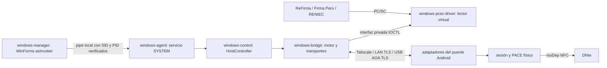

# Arquitectura actual · motor 2.0 y gestor Windows rc4

2026-10-07 · H8: módulo JVM dnie-validation-core, control local previo a CMS, consulta Android manual OCSP/CRL y rechazo de revocación conocida. 215 pruebas pasan y OCSP real firmado devuelve GOOD con confianza UNKNOWN. APK 59 compilado; UI física pendiente. Confianza TSL, cadena completa y preflight online automático siguen pendientes. [Arquitectura, límites y rutas](../suite/VALIDACION_CERTIFICADOS_H8.md).

2026-10-07 · H7: usuario confirma PDF Android 58 VÁLIDO y PAdES_BASELINE_B. Perfil DER sin signingTime y /M UTC trasladado a PDF desktop; 104 pruebas y demo sintético .NET pasan. GUI/CLI nuevas en D:/DNIeToolchain/Builds/pades-baseline-b, distribuciones anteriores preservadas. Pendiente clasificación externa de PDF Windows con DNI, revocación/TSL integradas y TSA. [Estado y rutas](../suite/PADES_BASELINE_DESKTOP_H7.md).

2026-10-07 · H5: GUI aislada `dnie-signing-ui`, preview/selector y firma privada sin consola; APK 57 implementa escaneo combinado certificados→ICAO con sesiones independientes y cancelación que conserva completos. 265 pruebas pasan. GUI inspeccionada sin DNI; firma GUI pendiente. APK 57 instalado por ADB y versión verificada el 2026-10-07; usuario confirma que funciona el escaneo unificado, sin desglose de bloques ni prueba de cancelación. DNI Bridge/inspección pública Windows son próximos adaptadores, no funciones ya integradas. [Contexto, rutas y límites](../suite/INTERFAZ_AISLADA_Y_ESCANEO_UNIFICADO_H5.md).

2026-10-07 · H4: sello visible de escritorio modular implementado, page/box/fields/style por argumentos y apariencia del campo firmada incrementalmente. Pruebas sintéticas de giros/recortes, firmas sucesivas y render pasan; falta sello físico con DNI. H3 cierre confirmado manual Ctrl+C. [Uso y límites](../suite/PDF_VISIBLE_H4.md).

2026-10-07 · H3: PDF integrado invisible de escritorio implementado en módulo JVM `dnie-pdf-desktop` (PDFBox 3.0.8). Por defecto PDF → `_firmado.pdf`, otros → `.p7s`; `--pdf-mode detached` conserva el modo anterior. Simulación del ejecutable verificada independientemente .NET; prueba física con DNI pendiente. APK instalado 56 y transporte/motor NFC sin cambios funcionales. [Arquitectura, límites y procedimiento](../suite/PDF_INVISIBLE_H3.md).

Actualizado antes del reinicio, 2026-10-06. Este mapa describe la implementación existente; los trabajos no terminados están en [pendientes](../PENDIENTES_ACTUALES.md). La distribución 2.0 final aún requiere regresión física y resolver los pendientes de transporte/distribución.

## Separación de responsabilidades

La UI presenta estado y emite acciones. ViewModels y controladores coordinan casos de uso, exclusión mutua y cancelación. Adaptadores contienen APIs del sistema y almacenamiento. El motor posee protocolos, formatos y criptografía. Los motores no importan Compose/WinForms ni reciben ViewModels para ejecutar operaciones.

| Módulo | Responsabilidad | Dependencias internas de producción |
| --- | --- | --- |
| `dnie-core` | APDU, modelos, criptografía y certificados | Ninguna |
| `dnie-diagnostics-core` | Contrato de eventos estructurados sin datos privados | Ninguna |
| `dnie-protocol` | Sesiones DNI v3, IAS/PKI, PACE físico, SM, traducción de PACE PC | core, diagnostics-core |
| `dnie-nfc` | IsoDep y adaptación Android NFC | protocol |
| `dnie-icao` | Sesión ICAO independiente y lectura por bloques | protocol |
| `dnie-pdf` | Motor PDF/PAdES y sello visual Android | core, signing-core |
| `dnie-signing-core` | Contratos PDF, documentos/resultados y motor de lotes JVM; autorización limitada a una conexión | protocol, diagnostics-core |
| `dnie-signing-desktop` | CLI JVM, workspace/adaptadores locales y simulación explícita de suite (hito 0) | signing-core, signing-link |
| `dnie-signing-link` | Contrato privado de firma, endpoint con autorización/PIN móvil, cliente y framing de flujos; todavía sin transporte físico de suite | protocol |
| `dnie-vault-core` | Contenedor, catálogo y formatos cifrados de bóveda | Ninguna interna |
| `dnie-passkeys-core` | WebAuthn, CBOR/COSE y validación | diagnostics-core |
| `dnie-passkeys-android` | Credential Manager, almacén Android y autorización | passkeys-core, vault-core, protocol |
| `dnie-bridge-core` | Contratos/framing del puente y método de conexión | Ninguna interna |
| `dnie-bridge-android` | Sesión del puente y adaptación del traductor; acceso al contrato privado de suite todavía sin enlace físico | bridge-core, protocol, signing-link |
| `app` | Compose, ViewModels, casos de uso y adaptadores Android | Bibliotecas anteriores según función |

La tabla se contrastó con `settings.gradle.kts` y las dependencias `project(...)`. Los detalles de archivos de funcionalidades anteriores permanecen en [arquitectura del fork](../../ARQUITECTURA_FORK.md).

Actualización 2026-10-07: `dnie-pdf` depende también de `dnie-signing-core`, que aloja los contratos neutrales extraídos del módulo Android. `app` consume ambos y conserva `SigningWorkspace`/SAF/UI. Implementación y prueba pendiente del lote real: [motor de firma rc5](MOTOR_FIRMA_LOTES_RC5.md).

## Motor del DNI y del puente

| Responsabilidad | Entrada principal |
| --- | --- |
| Selección y firma DNI | `dnie-protocol`: V3PkiSession, DnieTransceiver |
| PACE físico / SM NFC | PaceHandler, PaceSecureChannel, PaceBridgeChannel |
| PACE del consumidor PC | PaceTranslationEndpoint, TerminalSecureMessaging, PcPaceNegotiator |
| Fragmentación / respuestas PC | PcResponseFragments |
| Consulta pública de certificados | PlainCertificateReadRoute |
| Consulta vacía de estado PIN | PlainPinStatusQuery |
| Sesión / reconexión Android | `dnie-bridge-android`: BridgeConnection, RestartablePaceCard, TranslatedPaceCard |
| Enlace / permiso / perfiles | `app/data/bridge`: BridgeTransportAdapter, TrustedPcStorage; adaptador de permiso USB |
| Coordinación visual | `app/ui/bridge`: BridgeViewModel y componentes de pantalla |

Invariantes: mantener IAS → PKI → PACE → PKI protegido. Las claves y SSC del PACE físico y del PACE emulado para PC son independientes. GET RESPONSE físico ocurre antes de desenvolver la respuesta protegida; fragmentos del PC se gestionan por separado. Reset/cierre elimina el estado correspondiente; una APDU protegida obsoleta no autoriza reutilizar claves o SSC. Integridad inválida y pérdida del transporte invalidan la sesión. Nunca repetir PIN, firmas ni APDU anteriores tras reconectar.

ICAO abre una conexión y sesión propias. Los bloques ausentes no impiden recuperar los completos; pérdida de transporte/integridad detiene esa sesión. EF.SOD contiene material del emisor, no el certificado de firma personal.

## Extremo Windows

Decisión 2026-10-07: el esquema siguiente describe **el puente compatible existente**, no la futura suite documental. La suite usa `dnie-signing-desktop → dnie-signing-link → transporte privado autenticado → endpoint Android → transceptor/PACE → DNI`, sin PC/SC ni servicio SYSTEM. H1a implementa motores/framing y pruebas simuladas; faltan autenticador, integración física y aprobación UI. Los originales y CMS permanecen en PC; PIN/CAN en Android. Detalle en [contexto de suite](../suite/CONTEXTO_SUITE_FIRMA.md).

| Componente | Posee | No posee |
| --- | --- | --- |
| windows-manager | UI, preferencias públicas, QR en memoria, entrada del instalador y selector opcional | Claves PACE/SSC, procesamiento APDU, controlador PC/SC |
| windows-control | Contratos acotados, autenticación local, SCM específico del servicio, vida del host y adaptación al motor | UI y shell administrativo genérico |
| windows-agent | ServiceMain, cancelación SCM, inscripción del propietario y ejecución SYSTEM | Ventanas, navegador, selección global de lectores |
| windows-bridge | TLS, sincronización tailnet, USB, sesiones y backend PC/SC | WinForms/Compose |
| windows-pcsc-driver | Lector virtual y ABI privada | NFC, PACE y sockets de red |
| windows-reader-selector | Selección limitada a procesos RENIEC reconocidos | Consentimiento por firma, control del servicio o prioridad global Windows |

`DNIeBridge.exe` es asInvoker. La elevación ocurre al instalar/reparar explícitamente. `DNIeBridgeAgent` es automático, LocalSystem; al iniciar abre solo el broker local. La GUI solicita iniciar el transporte. Un único HostController serializa mutaciones; inicio repetido del mismo perfil es idempotente y un perfil diferente requiere detener primero. Cerrar la GUI conserva el host, mientras cerrar el servicio cancela y limpia el motor. El selector opcional se solicita aparte, no elevado, y se retira al cerrar la GUI.

El pipe rechaza clientes remotos; ACL SYSTEM y propietario inscrito; reserva primera instancia; consulta TOKEN_USER nativamente bajo identificación. La GUI verifica PID contra SCM. JSON limitado a 65536 bytes y plazos; respuesta con acuse antes de desconectar para no perder bytes. Solo operaciones específicas: status/start/stop/pairing/usb-devices; diagnostics existe únicamente en Debug. El instalador valida hashes y conserva la identidad, sin cambiarla a otro propietario.

## Transportes y límites de confianza

| Método | Enlace real | Autorización | Estado |
| --- | --- | --- | --- |
| Tailscale | Socket permitido entre pares de la tailnet; DNISYNC1 en el mismo enlace | Verificación del par Tailscale; cifrado de Tailscale; autorización Android | Evidencia física anterior; regresión del gestor nuevo pendiente |
| LAN | PC inicia TCP hacia el teléfono; PC sigue siendo el servidor TLS | Huella fijada, token persistente y autorización Android | Simulación validada; prueba real pendiente |
| USB | AOA: controles 51/52/53 y endpoints bulk, adaptación propia de UsbDk | Permiso de accesorio, TLS con huella/token y autorización Android | Implementado; teléfono no enumerado antes del reinicio |

USB actual no utiliza ADB, RNDIS ni compartir Internet. No bajar LAN/USB a texto plano para intentar resolverlos. El acuse DNIREADY1 prepara el transporte y no sustituye la autenticación. Tailscale sin TLS adicional solo se usa con su verificación/cifrado propio.

La PC autorizada sigue siendo un extremo de confianza: otros consumidores locales PC/SC pueden solicitar operaciones durante la sesión. La ACL del broker y el selector no equivalen a permiso por aplicación o por firma. Ese consentimiento sigue pendiente. Release omite la UI/comandos de desarrollo; Debug limita fases del broker y la captura APDU móvil es opt-in en sus fuentes de desarrollo. No guardar PIN, CAN, identidad ICAO ni tokens en Git.

## Persistencia y puntos de operación

- `D:/DNIeBridgeApp/versions/<versión>`: binarios administrativos, propietario con lectura/ejecución.
- `D:/DNIeBridgeApp/state`: inscripción e identidad TLS; ACL SYSTEM/administradores. Certificado y metadatos anteriores migrados exactamente.
- `%LOCALAPPDATA%/DNIeBridge/Manager/settings.json`: preferencias públicas; sin credenciales.
- Android: TrustedPcStorage cifrado mediante Keystore, perfiles por transporte. CAN compartido pertenece a su almacén de preferencias; bóveda no usa biometría. Biometría opcional de passkeys no se extiende a bóveda.
- `D:/DNIeToolchain/Checkpoints`: paquetes, hashes y resultados; material privado de ejecución permanece fuera de Git.

La identidad TLS estable no es un certificado personal DNI ni una firma de producción del controlador. Renovar el DNI/certificados y migrar bóveda/passkeys son problemas distintos. No restaurar el minidriver DNI ni reinstalar drivers automáticamente al retomar. No cambiar Hello, CertPropSvc, SCardSvr o firewall para probar el puente.

Pruebas, versiones concretas y rutas instaladas: [estado antes del reinicio](../operations/RETOMAR_TRAS_REINICIO_RC4.md). Para compilar el gestor: [README nativo](../../tools/windows-manager/README.md).

## Suite privada H1b — 2026-10-07

Ruta independiente del puente compatible: CLI `remote` y preparación CMS en `dnie-signing-desktop` → TLS inverso autenticado en `dnie-signing-link` → coordinación de consentimiento en `ui/suite` → adaptador Android en `data/suite` → transceptor NFC/PACE existente. El frontend no implementa APDU/PACE. El PIN/CAN permanecen en Android; documentos/CMS y workspace, en PC. No se publica lector global ni se amplía SYSTEM. Primera firma física LAN y verificación independiente completadas; [contrato, evidencia y límites](../suite/FIRMA_REMOTA_H1B.md).

## Suite H2 — sesión continua

Confianza persistente PC separada de trabajos: `SuitePcIdentity`/DPAPI y `SuiteTrustStorage`/Keystore. TLS inverso foreground sin inactividad entre lotes; `SuitePackets` define sobre H2 y `ContinuousSigningConnection`/cliente separan jobs con PIN PC por trabajo. `SuiteCardSlot` posee NFC/PACE entre jobs y descarta tarjeta al fallar. UI móvil coordina adapters, CLI Windows interactiva sin eco llama al motor CMS. No PC/SC ni SYSTEM en esta ruta. APK 55 instalado, tests sintéticos pasan; físico pendiente. [Detalle](../suite/SESION_CONTINUA_H2.md).

rc8 agrega `SuiteCardState`/StateFlow al ownership NFC; el adaptador Android conecta IsoDep en IO y ViewModel coordina consulta nativa de presencia sin APDU durante reposo. Compose presenta estado PC y DNI por separado. NOT_READY termina un trabajo sin tarjeta conservando TLS. Diagnóstico enum de fase/status sin secretos. `SuitePairingPresenter` es presentación opcional QR Windows, separada de identidad/transporte. Evidencia física H2 CMS comprobada; retirada/reaproximación rc8 pendiente.
