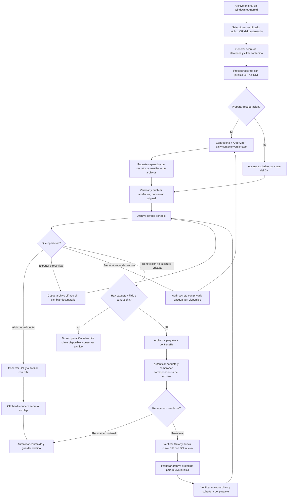

# Ciclo de vida del archivo y plan de pruebas de recuperación

2026-10-07. Usuario autoriza iniciar las pruebas. Prototipo JVM aislado implementado y 12 pruebas nuevas superadas en Windows: [resultados y límites](PRUEBAS_RECUPERACION_WINDOWS_R1.md). Android y cruces entre plataformas siguen pendientes. Continúa la arquitectura portable CIF hard con paquete separado opcional, sin biometría en bóveda ni privada permanente de app requerida para abrir archivos.

## Flujo propuesto

## Condiciones del flujo

- El archivo habitual lleva el sobre CIF y sus metadatos necesarios para descifrar en un equipo compatible nuevo. No necesita paquete, contraseña ni secreto residente en ese equipo cuando la privada original del DNI sigue disponible.
- El paquete no es el ZIP actual de VaultBackup: es un artefacto de recuperación nuevo, cifrado/autenticado, con sal, versión KDF, identidad contextual histórica, identificadores de archivos y secretos mínimos. La contraseña no se guarda en él.
- Al cifrar se conocen temporalmente los secretos nuevos y puede prepararse recuperación sin descifrar con el DNI. Si se incorpora un archivo ya cifrado, hay que abrirlo con la clave antigua antes de preparar su entrada.
- La sal y parámetros viajan con el paquete: recuperar no depende de certificado actual, root local, Keystore, teléfono original ni identidad recalculada del certificado nuevo.
- Contraseña/paquete permiten recuperación sin la privada antigua. Un DNI nuevo sirve para reenlace verificado, no para recrear matemáticamente la privada anterior. La copia cifrada anterior sigue ligada a su destinatario original.
- No prometer un reenlace que solo edite la cabecera: DNIEVLT1 autentica el sobre dentro de envelopeAad. El motor deberá abrir/reproteger el keyset y verificar compatibilidad de AAD; si requiere recifrado, usar streaming y staging. Nunca modificar bytes autenticados sin recalcular protección.
- Publicación transaccional: cada artefacto se escribe en staging y se verifica. Archivo y paquete pueden estar en sistemas/SAF diferentes, sin commit atómico conjunto: conservar estado de cobertura y marcar recuperable solo tras verificar ambos. Conservar original/cifrado antiguo ante cualquier fallo.
- Paquete perdido o no actualizado implica recuperación incompleta. Mostrar cobertura; añadir archivo no supone que un paquete externo antiguo se actualice solo.
- Cambiar contraseña no invalida paquetes anteriores. Rotación por compromiso es otra operación. No publicar secretos recuperados ni plaintext hasta verificar autenticidad completa.
- No efectuar renovación real ni borrar claves del DNI para las pruebas. Simular sustitución mediante parejas independientes.

## Orden de implementación y pruebas tras conformidad

1. **Windows/JVM, motor neutral:** definir versión y codec del paquete, KDF con perfiles acotados, envoltura autenticada, cobertura y API de recuperación. Reutilizar núcleo/Tink/contratos; adaptadores de archivo separados de UI. No introducir dependencia de PCSC para pruebas sintéticas.
2. **Pruebas sintéticas Windows:** KDF con vectores; creación/lectura; contraseña equivocada; manipulación/truncado/UUID/identidad; límites KDF; sal persistida; paquete desactualizado; varias entradas; cortes y carreras; conservación de original. Misma identidad con pública nueva no abre sobre viejo; paquete correcto sí permite recuperar y preparar destino nuevo.
3. **Android:** consumir el mismo motor, sin copiar criptografía al ViewModel. Adaptadores SAF, cancelación, progreso y trabajo fuera de UI. Medir memoria/latencia Argon2id antes de fijar perfil de producción; probar muerte de proceso y destino sin permiso/espacio.
4. **Cruce sintético de formatos:** Windows cifra → Android descifra/recupera; Android cifra → Windows descifra/recupera. Verificar bytes/hashes/metadata y errores idénticos con fixtures públicos. Esto demuestra interoperabilidad de formatos, no soporte real del DNI.
5. **Cruce real con DNI:** un archivo cifrado en Windows se abre con CIF hard en Android; uno cifrado en Android se abre en Windows mediante una ruta hardware definida. La suite privada actual es de firma: no asumir que ya soporta descifrado remoto de bóveda. Decidir/probar su adaptador o usar una ruta física comprobada antes de anunciar ese sentido del cruce como completo.
6. **Recuperación real sin renovar DNI:** recuperar ambos archivos con paquetes y contraseña en ambos extremos, comparar contenido y probar fallo seguro. Reenlace a clave diferente simulado. Reenlace a segundo DNI real solo si se dispone de él y se prueba identidad/política; no usar certificado sintético como sustituto automático del DNI real.
7. **Regresión:** firma PDF/lotes/suite, bóveda actual, passkeys y BE/BS. Passkeys requieren respaldo propio y elegibilidad; recuperar archivos no acredita recuperación de credenciales.

## Criterio de aceptación

Formato portable documentado; resultados sintéticos e interoperabilidad reproducibles; dos archivos reales conservan nombre/MIME/contenido; acceso habitual CIF hard mantiene portabilidad; recuperación no depende de privada antigua y demuestra cobertura; errores no alteran origen ni publican plaintext parcial. Registrar por separado pruebas implementadas, sintéticas y físicas pendientes.

Estado actual: propuesta y plan, sin motor/paquete de recuperación desplegado.
