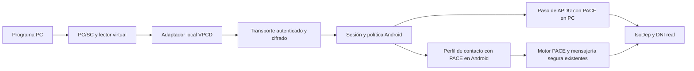

# Transporte VPCD y adaptación PACE para el puente 2.0

## Estado del trabajo

Investigación estática completada sobre el JAR local y el proyecto fuente de la app del teléfono. No se ejecutaron los motores oficiales, no se repitió una operación autenticada y no se cambió la app funcional. Las copias y descompilaciones están en `build/research`, ignoradas por Git. Este documento define integración y pruebas; todavía no hay puente PACE instalado.

Hay que corregir la hipótesis anterior: que el lector sea físico no determina quién ejecuta PACE. El JAR descargado contiene una ruta de validación que ejecuta PACE en la PC. Para otras apps que esperan APDU por contacto sí necesitamos terminación PACE en Android. No se deben mezclar ambas sesiones.

## Fuente de Smart Card Reader

El teléfono informa paquete `com.vsmartcard.remotesmartcardreader.app`, versionName 2.4, versionCode 8. El proyecto correspondiente es [vsmartcard/remote-reader](https://github.com/frankmorgner/vsmartcard/tree/8a411e3672e843f9bb9fd750fc8dc56a26bb3bc8/remote-reader). Se descargó el commit `8a411e3672e843f9bb9fd750fc8dc56a26bb3bc8` en `build/research/vsmartcard-source`. Su Gradle declara el mismo paquete y versión. El target SDK del código actual es 34 y el instalado es 30: se identificó el proyecto, no se probó correspondencia binaria exacta de ese commit con el APK instalado.

Archivos revisados, todos relativos a `remote-reader/app/src/main/java/com/vsmartcard/remotesmartcardreader/app`:

| Archivo | Responsabilidad | Uso previsto |
|---|---|---|
| VPCDWorker.java | framing TCP, cliente/servidor, controles y entrega de APDU | referencia para adaptador VPCD |
| screaders/SCReader.java | contrato powerOn/powerOff/reset/getATR/transmit/eject | separación transporte/motor útil |
| screaders/NFCReader.java | IsoDep, ATR derivado del NFC y transmisión directa | sustituir por nuestro adaptador de sesión |
| MainActivity.java | descubrimiento NFC, creación/cancelación del worker | mover coordinación a servicio dedicado |

`NFCReader.transmit` llama directamente a `IsoDep.transceive`. No establece PACE. `reset` y `powerOff` envían un SELECT MF, sin desconexión física: no podemos asumir que eso equivale a un reset eléctrico ni que invalida toda sesión del chip. El ATR se construye con los bytes históricos de NFC y checksum, sin identificación criptográfica del documento.

`VPCDWorker` registra C-APDU y R-APDU completas. No reutilizar ese logging para operaciones reales: podría contener PIN, identidad y material de autenticación. La cancelación inicial cierra el socket de cliente; el listener se cierra después en la limpieza. Con nuevos descubrimientos NFC, esa limpieza asíncrona ofrece una explicación plausible para la colisión de puerto observada, además de la configuración servidor activa. Debe haber un único worker y un cierre completo antes de reemplazarlo.

## Licencia y decisión de reutilización

Los archivos del motor declaran GPL versión 3 o posterior y el proyecto incluye COPYING. No es MIT. Un fork distribuido que incorpore ese código debe conservar avisos, licencia y las obligaciones de entrega del código fuente correspondiente. Separarlo en un módulo no convierte su licencia en MIT.

Propuesta para este repositorio: implementar un adaptador VPCD propio a partir del [protocolo público](https://frankmorgner.github.io/vsmartcard/virtualsmartcard/api.html), sin copiar la implementación GPL. Nuestro motor PACE/NFC ya existe. Mantener el fork GPL de Remote Smart Card Reader como alternativa de laboratorio si se decide expresamente distribuirlo bajo esas condiciones. El driver Bix existente puede servir en pruebas; no se ha resuelto su distribución/instalación como producto Windows.

## Qué ejecuta la validación Java

JAR inspeccionado: `.dcdelivery-2.0/files/dcdeliverydnie3.jar`, SHA-256 `B46DD7FA9ABCC26E047F75E598FE7B5A34BE4AC44E7111E45F34698894CC67FD`. Se usó CFR 0.152 como lector de bytecode, sin ejecutar clases del JAR.

La ruta `reniec.pkiep.App.ejecutar` realiza:

1. `DnieComponent.connect`: enumera CARD_PRESENT, abre CardService/PassportService, identifica versión mediante SELECT v2/IAS v3 y vuelve a seleccionar IAS con P2=04 y Le=00.
2. `DnieComponent.doPACE`: lee EF.CardAccess 011C, toma el primer PACEInfo, crea una clave CAN y llama a JMRTD PassportService.doPACE. Exige verificación de MAC.
3. `Dniev3DfReniecReader.read`: selecciona la aplicación Identity y EF 4F00 y lee el contenido usando el wrapper de mensajería segura de la PC.
4. `PkiCheckerv3.readCertificates`: vuelve a seleccionar IAS y Generic/PKI mediante CardService.transmit directo, selecciona certificados CE82/CE81 y lee por bloques de 255 bytes hasta 6282. Esa ruta no usa el wrapper PACE para esas APDU.
5. Serializa información y certificados al stdout para que el lanzador .NET notifique el resultado.

| Etapa | APDU o dato esperado | Dueño del canal |
|---|---|---|
| Identificación .NET | SELECT IAS `00A4040C10A000000077030C60000000FE00000500` | sin SM |
| Nueva selección Java | SELECT IAS `00A4040410A000000077030C60000000FE0000050000` | sin SM |
| Negociación | EF.CardAccess 011C, MSE/GENERAL AUTHENTICATE de JMRTD | PC |
| Identidad | AID `E828BD080FD2504964656E74697479`, EF 4F00 | SM de PC |
| Certificados | IAS y AID `E828BD080FD25047656E65726963`, EF CE82/CE81 | APDU directas del Java |

Las APDU exactas de negociación dependen de EF.CardAccess y JMRTD; no se inventa un transcript completo. CE83 figura como constante de cifrado pero no forma parte de la lista de certificados que devuelve esa ruta.

También hay rutas de postpersonalización que usan PACE y operaciones de administración; su presencia en el JAR no las autoriza ni demuestra que se ejecutaran durante nuestra validación.

### Selección de lector, ATR y error observado

La detección .NET elige el primer lector. La implementación Java de validación recorre CARD_PRESENT y conserva el último. Si hay varias tarjetas, podrían elegir lectores distintos. Debe comprobarse el nombre elegido en una captura futura.

En la ruta `reniec.pkiep.DnieComponent`, el ATR se compara para rechazar v1, pero la identificación v2/v3 depende de SELECT. Las listas SUPPORTED_ATRS encontradas en otra utilidad no demuestran una whitelist aplicada aquí. No falsificar un ATR Perú para solucionar el error.

El mensaje sobre conectar correctamente el DNI aparece cuando Java no reconoce ni v2 ni v3. Eso no significa automáticamente ausencia de PACE: es anterior a su negociación. Nuestra última traza solo muestra la detección .NET satisfactoria; no incluye un segundo par de SELECT ni el SELECT con P2=04 del Java. No sabemos si el motor Java llegó a ese punto. El muestreo anterior tampoco observaba java.exe. El diagnóstico siguiente debe incluir Java y excepciones filtradas, sin argumentos de proceso, CAN o resultados personales.

## Arquitectura propuesta

Separación prevista:

- `dnie-bridge-core`, JVM: framing, controles VPCD, límites, estados, perfiles, cancelación, orden de comandos y diagnósticos sin payload. No Android, sockets ni UI.
- `dnie-protocol`: fachada estrecha para abrir una sesión PKI y transmitir APDU lógicas mediante el canal seguro existente. V3PkiSession mantiene IAS → PKI → PACE → PKI protegido; PaceSecureChannel mantiene MAC/SSC y GET RESPONSE físico. No usar un ViewModel ni duplicar criptografía.
- `dnie-bridge-android`: transporte autorizado, conexión NFC exclusiva, servicio con estado visible y limpieza. CAN local; no enviarlo a la PC en el perfil de contacto.
- `app/ui/bridge`: emparejamiento, consentimiento y progreso; ninguna criptografía o parsing de APDU en Compose.
- host: traduce VPCD local a transporte cifrado. El protocolo VPCD no incorpora cifrado/autenticación propios; no exponer ese puerto directamente como diseño de producto.

### Perfiles separados

**Paso NFC:** la PC posee PACE, claves y SSC. Android transmite APDU sin envolverlas otra vez. Reset/desconexión requieren coordinación real, no un SELECT MF usado como reset universal.

**Contacto adaptado:** Android posee PACE/SSC. Las APDU lógicas autorizadas de PC se adaptan y protegen; respuestas se verifican y desprotegen. Rechazar APDU SM/PACE entrantes en ese perfil antes de transmitir: no intentar doble envoltura ni éxito simulado. IAS/PKI y selección de EF deben respetar el estado real. El perfil inicial puede limitarse a lectura; PIN/firma requieren autorización explícita de la operación y no reintentar automáticamente.

**Ruta mixta Ciudadano Digital:** necesita investigación adicional. No cambiar silenciosamente entre propietarios de PACE cuando el Java pasa de identidad SM a certificados directos. Opciones futuras: reset verificable y nueva sesión PKI en Android al entrar en esa fase, o adaptador específico por operación. Ninguna se considera compatible hasta probar selección, lectura y resets con DNI real. No necesitamos emular un servidor PACE ni fabricar tokens/MAC para fingir que el DNI autenticó.

## Orden de implementación y aceptación

1. Captura mejorada de Java/PCSC y prueba controlada de selección IAS con P2=04 y lectura de EF.CardAccess, manteniendo respuestas reales. Identificar pérdida NFC, lector elegido o fallo de arranque antes de modificar protocolos.
2. Codec VPCD y máquina de estados con pruebas de frames fragmentados, controles, límites, cierre, sustitución de tarjeta y comandos simultáneos. Un solo comando en vuelo y una sola sesión NFC.
3. Adaptador de solo lectura con PACE en Android; probar lectura de certificados en una herramienta PCSC local antes de usar el portal oficial.
4. Transporte cifrado y emparejamiento; validación de identidad de ambos extremos, revocación y timeout. USB no exime de autorización. El permiso LAN sin cifrado de la última prueba fue solo para esa ocasión.
5. Extender a PIN/firma después de validar permisos por operación, selección de clave, resets y pérdida de conexión. Administración de tarjeta queda fuera del perfil inicial.

Pruebas necesarias: el profile de paso nunca llama al motor PACE Android; el adaptado rechaza APDU protegidas de PC; reset invalida estado y PIN verificado; MAC inválido/lost tag retira la tarjeta y no entrega plaintext; fragmentación TCP no divide APDU; ni PIN/CAN ni datos de respuesta aparecen en logs; no hay 9000 artificial; error de integridad no produce reintento con SSC reutilizado. Compilar APK y ejecutar módulos afectados al comenzar los cambios de implementación.
