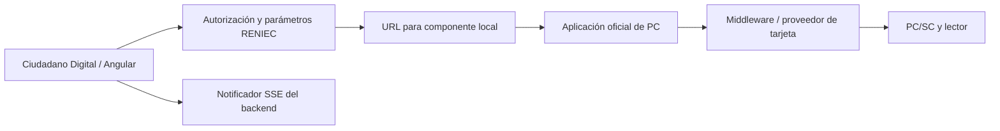

# Puente Android NFC → PC: investigación y plan para 2.0

Fecha: 2026-10-05. Estado: investigación pública y diseño; no hay puente implementado ni compatibilidad real comprobada. Se revisó `AGENTS.md`. Esta investigación no accedió a cuentas, documentos personales, sesiones de RENIEC ni operaciones de emisión, renovación o cambio de PIN.

## Decisión propuesta

El primer prototipo de motor debe ofrecer **operaciones criptográficas limitadas desde PC**, conservando NFC, PACE, CAN, PIN y claves privadas en Android/DNI. La elección del adaptador depende del consumidor: para el componente oficial Windows se prioriza un spike de **lector PC/SC virtual con perfil contactless**, utilizando el middleware oficial, antes de escribir un CSP/KSP propio; para programas que carguen explícitamente PKCS#11 se evalúa ese proveedor. Retransmitir bytes por sí solo no garantiza compatibilidad con DNIe v3 NFC.

La inspección posterior del MSI oficial IDplug 4.6.1 encontró registros declarados para **Peru DNIe Contactless Device**, además del perfil de contacto, asociados al minidriver Perú y a Base CSP/Smart Card KSP de Microsoft. Es evidencia de soporte contactless declarado por el paquete, no una prueba de compatibilidad con Android o nuestro PACE. La instalación real fue intentada y bloqueada por Error 1925/falta de privilegios; no se modificó manualmente el registro ni se sustituyeron ATR del host. Véase [inspección reproducible](INSPECCION_HOST_RENIEC.md).

No se propone modificar Ciudadano Digital ni sustituir sus controles de autorización. El punto inicial de integración es debajo del componente local oficial, por las interfaces de tarjeta/proveedor que utilice. La integración directa con su protocolo de lanzamiento necesitaría una especificación o una prueba autorizada adicional.

## Lo comprobado en Ciudadano Digital

Se descargaron en memoria el HTML público y sus archivos JavaScript enlazados, usando únicamente GET de recursos estáticos. El sitio actual entrega una aplicación Angular con `main-AU6SY7YH.js`, `chunk-WCXMVV2V.js` y el módulo de operaciones `chunk-NWAYOVMI.js`. Estos nombres son huellas de esta revisión y pueden cambiar en otra publicación. [Página pública](https://pki.reniec.gob.pe/ciudadanodigital/index.html), [entrada JS](https://pki.reniec.gob.pe/ciudadanodigital/main-AU6SY7YH.js).

El módulo público expone el flujo: preparación/lectura del DNI → validación de identidad mediante ID Perú → descarga/renovación de certificados o desbloqueo/cambio de PIN. La guía menciona un componente local de lectura. El texto de requisitos indica lector ISO 7816 y Edge; otra sección de ayuda también menciona Chrome. Esa discrepancia no demuestra soporte universal de navegador. [Operaciones y guía públicas](https://pki.reniec.gob.pe/ciudadanodigital/chunk-NWAYOVMI.js).

La configuración publicada usa como backend `https://pki.reniec.gob.pe/ciudadanodigital`. Los nombres observados en el servicio frontend incluyen `/autorizar`, `/parametros/url-validacion`, `/parametros/url-inyeccion`, `/parametros/url-desbloqueo`, y rutas de autenticación/estado. No se invocaron esos endpoints, ni se enviaron números DNI o tokens. [Configuración/servicios públicos](https://pki.reniec.gob.pe/ciudadanodigital/chunk-WCXMVV2V.js).

El frontend obtiene una URL del backend y la pasa a `window.location.href` para abrir la aplicación local. Espera el resultado mediante `EventSource` (SSE) hacia un notificador del backend; el código construye esa conexión con un token de autorización en query. No se registraron ni obtuvieron tokens reales. **No se encontró una API APDU pública, ni un WebSocket localhost de lector, en estos flujos revisados.** Esto es una observación del código entregado, no una prueba de que no existan otras integraciones.

Las últimas tres conexiones son **hipótesis de arquitectura a verificar** con importaciones, configuración y comportamiento del componente local; el JS no revela la biblioteca, proveedor ni conjunto de APDU que este ejecuta. RENIEC publica instaladores distintos para DNIe v1/v2 y v3 y manuales técnicos. La guía v3 ilustra establecimiento de canal seguro y solicitud del CAN, evidencia de que el entorno oficial también tiene una capa de acceso seguro. [Descargas oficiales](https://identidad.reniec.gob.pe/dni-electronico), [guía v3](https://identidad.reniec.gob.pe/documents/d/guest/guia_dnie_version3).

## Tres formas de conexión y sus límites

| Vía | Qué entrega a la app PC | Trabajo necesario | Limitación |
| --- | --- | --- | --- |
| Operaciones semánticas | Certificados públicos y resultados de firma, con algoritmo/clave explícitos | Companion PC + canal autenticado + motor Android | Funciona con apps que adopten nuestra API; no aparece como lector físico |
| PKCS#11 | Slot/token, objetos certificado/clave y `C_Sign`, sesiones/login | DLL/so y adaptación a operaciones Android | Apps deben admitir y cargar ese módulo; no equivale a CAPI/CNG de Windows |
| Lector virtual PC/SC | Inserción/extracción, atributos, transacciones y APDU mediante WinSCard | Driver de lector y perfil virtual compatible | El middleware aún puede rechazar ATR, comandos, PACE o comportamiento de tarjeta |
| Proveedor Windows CSP/KSP / minidriver | Claves/certificados consumibles mediante API Windows | Provider o minidriver, registro y distribución apropiados | No se obtiene simplemente instalando PKCS#11 o creando un lector virtual |

Microsoft separa lector/resource manager de las operaciones criptográficas del minidriver/Base CSP/KSP. Además hay requisitos específicos de firma para cargar plugins en procesos protegidos/LSA; no es correcto prometer inicio de sesión Windows ni distribución sin resolverlos. [Arquitectura de minidrivers](https://learn.microsoft.com/en-us/windows-hardware/drivers/smartcard/smart-card-minidrivers), [requisitos y transacciones](https://learn.microsoft.com/en-us/windows-hardware/drivers/smartcard/smart-card-minidriver-overview), [SCardTransmit](https://learn.microsoft.com/en-us/windows/win32/api/winscard/nf-winscard-scardtransmit).

### PACE: un único dueño

Para el prototipo semántico, Android es dueño de la sesión IAS → PKI → PACE → PKI protegido. Solo Android conserva claves SM, SSC, selección de archivos y estado de PIN. La PC recibe únicamente resultados necesarios para su operación. Reutilizar `V3PkiSession` / `DnieCardChannel` mediante un caso de uso, nunca un ViewModel como servicio.

En un lector PC/SC deben distinguirse dos perfiles incompatibles:

1. **Relé físico sin terminación PACE en Android:** PC/middleware ejecuta PACE completo; Android solo transmite. Exige que ese middleware soporte exactamente el acceso NFC observado. No satisface el diseño donde CAN/PIN permanecen exclusivamente en Android si el cliente PC insiste en suministrarlos.
2. **Terminación PACE en Android:** PC envía APDU lógicos sin SM, Android los protege y devuelve respuestas desenvueltas. Exige conocer el perfil que espera PC, su selección de aplicaciones, reset y manejo de PIN. Si el middleware intenta ejecutar su propio PACE o SM encima, se rechaza; no se mezclan SSC ni capas de cifrado.

No se debe ofrecer una autodetección que cambie de perfil a mitad de sesión. El perfil se negocia antes de conectar la tarjeta, y cualquier cambio obliga a cerrar RF y reiniciar. Un ATR virtual no demuestra equivalencia con contacto: `IsoDep` ofrece bytes históricos/respuesta de nivel superior de ISO-DEP, no un ATR de contacto completo. [API IsoDep](https://developer.android.com/reference/android/nfc/tech/IsoDep).

Un relé APDU transparente deja que el programa PC envíe VERIFY, cambio de PIN o escritura. La política de PIN local implica interceptar/negar esos comandos o usar la interfaz de entrada protegida que soporte el cliente, por lo que debe documentarse esa pérdida de transparencia. El prototipo no debe fingir éxito de VERIFY ni ocultar un fallo de transporte como un SW de tarjeta.

## Proyectos y licencias revisados

Las licencias se revisaron en el archivo del repositorio o documentación del autor. Antes de adoptar se fijará commit, inventario de dependencias transitivas y avisos; esta tabla no constituye una aprobación automática de distribución.

| Proyecto | Licencia verificada | Aplicación posible / cautela |
| --- | --- | --- |
| [pcsc-rust](https://github.com/bluetech/pcsc-rust) | [MIT](https://github.com/bluetech/pcsc-rust/blob/master/LICENSE-MIT) | Cliente PC/SC Windows/Linux/macOS, comparación con lector real; **no crea un lector virtual** |
| [Java-WebSocket](https://github.com/TooTallNate/Java-WebSocket) | [MIT](https://github.com/TooTallNate/Java-WebSocket/blob/master/LICENSE) | Transporte WSS JVM/Android; pairing, certificados, autorización y límites siguen siendo responsabilidad propia |
| [rustls](https://github.com/rustls/rustls) | [MIT disponible](https://github.com/rustls/rustls/blob/main/LICENSE-MIT) | TLS de companion Rust; comprobar backend criptográfico/dependencias elegidas |
| [markkurossi/pkcs11-provider](https://github.com/markkurossi/pkcs11-provider) | [MIT](https://github.com/markkurossi/pkcs11-provider/blob/master/LICENSE) | Referencia de implementación de proveedor; no listo para DNIe, requiere evaluación de cobertura/mantenimiento |
| [aws-kms-pkcs11](https://github.com/JackOfMostTrades/aws-kms-pkcs11) | [MIT](https://github.com/JackOfMostTrades/aws-kms-pkcs11/blob/master/LICENSE) | Ejemplo de proveedor PKCS#11 con firma remota. Backend AWS ajeno al diseño; no copiar su política sin PIN |
| [pcsc-sharp](https://github.com/danm-de/pcsc-sharp) | [BSD de 2 cláusulas](https://github.com/danm-de/pcsc-sharp/blob/master/COPYING.txt) | Opción .NET para diagnóstico/cliente PCSC; declara expresamente que no incluye drivers |
| [Pkcs11Interop](https://github.com/Pkcs11Interop/Pkcs11Interop) | [Apache-2.0](https://github.com/Pkcs11Interop/Pkcs11Interop/blob/master/LICENSE.md) | Cliente de prueba .NET para módulo propio; no implementa automáticamente proveedor |
| [Remote Smart Card Reader / vsmartcard](https://frankmorgner.github.io/vsmartcard/remote-reader/README.html) | [GPLv3](https://github.com/frankmorgner/vsmartcard/blob/master/remote-reader/COPYING) | Demuestra relé NFC Android a lector vpcd. Útil como referencia/prueba separada; no es MIT, no mezclar código sin decisión de licencia |
| [OpenSC](https://github.com/OpenSC/OpenSC) | [LGPL-2.1](https://github.com/OpenSC/OpenSC/blob/master/COPYING) | Referencia PCSC/PKCS#11/minidriver; soporte de otras tarjetas no prueba soporte DNIe v3 |
| [Windows driver samples](https://github.com/microsoft/Windows-driver-samples) | [MS-PL](https://github.com/microsoft/Windows-driver-samples/blob/main/LICENSE) | Referencia WDF; no MIT y no entrega un puente DNIe listo |

`vsmartcard/virtualsmartcard/win32/BixVReader` existe como referencia Windows, pero no se verificó una licencia MIT específica para ese subconjunto ni su carga en Windows moderno. No recomendarlo como driver listo para producción. La documentación de Remote Reader advierte del uso como relé con acceso a la tarjeta; ese riesgo guía el diseño de consentimiento y capacidades.

## Comunicación segura, por USB y por red

Los APDU en claro pueden existir **dentro de los procesos autorizados** antes/después de SM; no circularán sin cifrar por Wi-Fi, Bluetooth ni USB. PACE protege teléfono↔DNI, no PC↔teléfono.

Diseño propuesto:

- Canal TLS 1.3 con autenticación mutua y claves de dispositivo; pairing inicial mediante QR con huella de la clave PC, nonce de alta entropía y vencimiento corto, confirmando ambos dispositivos. Un código numérico corto solo sirve como comparación visual, no como único secreto para cifrar. [TLS 1.3](https://www.rfc-editor.org/rfc/rfc8446).
- Clave Android en Keystore y clave PC en almacén protegido del usuario; lista explícita de PCs enlazadas y revocación. Reinstalar/rotar una identidad requiere pairing nuevo.
- USB inicial de laboratorio con `adb forward` y socket local únicamente, cifrado/pairing igualmente obligatorios. ADB no es interfaz de producción. Después evaluar Android Open Accessory, que necesita soporte real del dispositivo y software host. Una app Android común no se transforma en USB CCID solo por usar cable; el API de accesorio y un lector CCID son protocolos distintos. [Android USB accessory](https://developer.android.com/develop/connectivity/usb/accessory).
- Wi-Fi local posterior, listener solo en interfaz elegida durante sesión visible; firewall limitado al par, sin UPnP, sin exposición WAN, sin relay cloud obligatorio. Loopback para consumidores PC; preferir IPC local con ACL al usuario/proceso antes que un HTTP abierto a cualquier página web.
- Capacidades iniciales `ReadCertificates`, `SignDigest` y estado/cierre; no APDU arbitrario, PIN/CAN remoto, escritura, desbloqueo ni inyección de certificados. Identificar clave por huella y uso; limitar algoritmos, tamaño y propósito. Una firma de hash no demuestra al teléfono el contenido del documento: si solo llega un hash, mostrar esa limitación al aprobar.
- Android confirma inicio y cada operación sensible o lote previamente definido. UI muestra PC y propósito declarado; un nombre suministrado por el cliente no prueba el sitio/origen. El companion identifica proceso local cuando el sistema lo permite; no atribuir seguridad de navegador a un simple string.
- Sesión única con lease, límites de tamaño, requestId y contador ordenado, deadline y presupuesto de comandos; nada de reintentos automáticos de VERIFY/firma/escritura tras timeout ambiguo. No usar TLS 0-RTT para operaciones sensibles.
- Una cola/owner de tarjeta excluye firma, bóveda, passkeys, ICAO y puente concurrentes. Desconexión RF/red/USB, cancelación, background no autorizado o pérdida de integridad invalidan sesión y SSC; se cierra el transporte y el próximo uso exige PACE nuevo.
- Logs solo de fase, clase de fallo, duración, tamaños y SW; sin APDU completos, token de pairing, PIN/CAN, certificados con identidad, documentos ni resultados privados descifrados. No persistir claves de sesión ni volcar buffers al diagnosticar.

Cifrar el transporte no protege de una PC comprometida ya autorizada, ni certifica proximidad física frente a relé. El consentimiento local y el alcance limitado reducen ese riesgo, no lo eliminan.

## Módulos y contrato propuestos

| Módulo futuro | Responsabilidad |
| --- | --- |
| `dnie-bridge-core` JVM | Mensajes versionados, capacidades, límites, máquina de estados, cancelación; sin Android/socket/Compose |
| Adaptador Android bridge | Pairing/Keystore, transporte, foreground lifecycle, reserva de tarjeta, ejecución de casos de uso |
| `desktop/companion` | Identidad PC, IPC local con ACL, pairing, disponibilidad y diagnósticos sanitizados |
| `desktop/pkcs11` | ABI PKCS#11, objetos públicos y handles no exportables, mecanismos declarados, sesiones/login y errores |
| Driver PCSC / provider Windows posterior | Estados de lector, transacciones/reset/atributos o integración CAPI/CNG según objetivo comprobado |

Estados: `Disconnected → Paired → AwaitingConsent → AwaitingCard → PaceReady → Authorized → Executing → Closed`. IDs efímeros, no usar número DNI como ID de sesión. Todo fallo crítico cierra y borra estado; no continuar una sesión incierta. Las abstracciones existentes de protocolo conservan MAC, SSC y GET RESPONSE físico previo al desenvolvimiento.

## Fases con criterios de salida

1. **Preparación tras deuda técnica:** mapa de módulos, reserva/cancelación NFC común y tests de sesión; checkpoint validado. Especificar mensajes y amenazas antes de abrir sockets.
2. **Harness de laboratorio sin DNI:** synthetic card, PC y Android/emulador; pairing inválido, replay, longitud excesiva, dos consumidores, timeout ambiguo, extracción y cancelación. No acceso a RENIEC. Prueba de TLS y ACL con procesos no autorizados.
3. **PC→Android por cable:** listar certificados y firmar desafío de prueba aprobado; verificar firma independiente en PC. Medir tiempos por transporte/PACE/PIN/operación y cierre. RF sigue exigiendo teléfono/DNI físicos.
4. **PKCS#11 experimental:** `C_GetSlotList`, objetos certificado/clave pública, `C_OpenSession`, `C_Login` con política PIN local, mecanismos mínimos `C_Sign`; errores explícitos en funciones no soportadas. Verificar búsqueda de objetos, bytes DER, IDs estables por certificado, padding/hash, tamaño de firma, cancelación y clientes de prueba.
5. **Windows y middleware oficial:** inspección read-only del instalador/componente oficial obtenido desde RENIEC; inventario de DLL/imports/registro (CSP/KSP/PKCS#11/WinSCard), arquitectura x86/x64, firmas de distribución y diálogo de PIN/CAN. Sin alterar DLL oficiales ni secuestrar su URL protocol. Comparar el perfil con una traza autorizada de lector real cuando esté disponible; actualmente usuario solo dispone de NFC.
6. **Lector virtual PCSC si es necesario:** ATR/perfil explícito, card present/removed, `SCardBegin/EndTransaction`, reconnect/reset, control de entrada protegida, APDU cortos/extendidos, SW/GET RESPONSE. Primera prueba con apps de lectura/firma, no con renovación/escritura. Resolver firma/instalación de driver antes de prometer distribución.
7. **Wi-Fi opt-in:** mismo contrato y TLS, pairing revocable, prueba MITM/red hostil y tiempos comparables; Bluetooth solo si hay una necesidad medida.

El hito 2.0 requiere que una **aplicación PC concreta**, con API identificada, haga una operación real usando la clave del DNI por NFC, que la firma sea verificable de forma independiente y que las pruebas negativas de seguridad/cancelación pasen. Abrir una ventana, enumerar un lector virtual o presentar un certificado no cumplen ese criterio.

## Pendientes explícitos

- Determinar ABI/importaciones reales del componente local Ciudadano Digital y middleware DNIe v3; el frontend público solo permite trazar el lanzamiento y la notificación.
- Probar APDU contacto frente a NFC/PACE y perfil esperado por middleware con lector físico o especificación fiable; no está disponible esa comparación todavía.
- Comprobar qué consumidores PC objetivo requieren PKCS#11, CAPI/CNG, lector PCSC o API propietaria. Priorizar una app concreta evita prometer compatibilidad universal.
- Validar PIN local con cada consumidor; algunos requieren un PIN como parámetro y no aceptan entrada protegida externa.
- Decidir licencia/distribución del driver PCSC; no se encontró un puente Windows completo MIT listo para DNIe.
- Emisión/renovación/inyección de certificados y cambio/desbloqueo de PIN quedan fuera del primer puente. Tienen autorización y protocolos adicionales; el plan no los trata como equivalentes a firmar.
- QR FIDO entre PC/teléfono pendiente de prueba del usuario permanece separado: un puente smartcard no implementa caBLE/CTAP hybrid ni valida automáticamente ese flujo.
