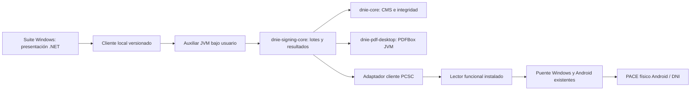

# Plan de la suite propia de firma

Fecha de revisión: 2026-10-07, America/Bogota. Referencia local: `7223401`, con motor compartido introducido en `c97e6e3`. Este documento propone desarrollo; no modifica motores, servicios, lectores o sesiones, ni instala dependencias.

## Decisión recomendada

Construir inicialmente una suite Windows con presentación .NET separada y un auxiliar local Kotlin/JVM que reutilice `dnie-core` y `dnie-signing-core`. Adaptar el PDF con Apache PDFBox de escritorio y conservar el lector PC/SC funcional. Antes de invertir en un visor o interfaz extensa, demostrar el contrato del cliente PC/SC con el traductor Android y su comportamiento después de otro consumidor.

Actualización de prioridad acordada el 2026-10-07: preparar el desarrollo para la próxima sesión, empezando por el motor local sin interfaz gráfica. Las firmas funcionales desde Firma Perú y ReFirma PCX son evidencia de que la cadena lector → puente → Android → DNI puede ejecutar operaciones privadas desde Windows. El trabajo inicial es reproducir ese comportamiento con nuestro cliente y portar los adaptadores de plataforma, conservando algoritmos y reglas probados. No reabrir el diseño del lector o de los transportes como condición general para construir la suite.

La firma PDF sin visor pertenece al motor y sí es prioritaria. La vista previa, el editor para colocar el sello y el diseño visual de la aplicación pertenecen a una fase posterior. El motor debe poder firmar un PDF con parámetros de página/posición proporcionados por un archivo de configuración o una orden local antes de disponer de un editor gráfico.

La suite hará propios la preparación, CMS, estampado, lotes y resultados; el lector seguirá siendo el adaptador de tarjeta. Esa edición no elimina la instalación del lector. El transporte directo al teléfono, PKCS#11 y simplificación del instalador son líneas posteriores, independientes de poder firmar documentos desde nuestra interfaz. Portable LAN no es el objetivo principal elegido por el usuario.

Procesamiento local significa que el original, la preparación PDF, hashes, CMS, resultados y catálogo se procesan en la PC, sin servidor externo ni subida de documentos. Android conserva el acceso NFC, PACE físico y operaciones con el DNI mediante el puente existente. Ese enlace sigue siendo necesario para la tarjeta; no requiere enviarle el documento completo. La primera entrega no depende de construir IPC con una GUI: el ejecutable JVM se prueba directamente por consola. La presentación .NET y su canal local se incorporan después.

Usar componentes MIT cuando aporten una función concreta. No sustituir el CMS probado solamente para cambiar la licencia de una dependencia ni incorporar una aplicación completa como plantilla. La licencia final de la suite propia todavía debe decidirse: no existe un LICENSE global que permita atribuir MIT a todo el repositorio.

## Contexto revisado y evidencia

Se revisaron AGENTS, ARQUITECTURA_FORK, CONTEXTO_ACTUAL, PENDIENTES_ACTUALES, RETOMAR_TRAS_REINICIO_RC4, ARQUITECTURA_ACTUAL_2_0, NUCLEO_FIRMA_SUITE_PROPIA, MOTOR_FIRMA_LOTES_RC5, VIABILIDAD_DISTRIBUCION_SIN_CONTROLADOR, GESTOR_NATIVO_WINDOWS_RC4 y AISLAMIENTO_USB_USBDK. Los encabezados antiguos de rc4/README no sustituyen las actualizaciones de contexto más recientes.

La ejecución física rc5 acredita cuatro documentos en 3,721 s, con una entrada PIN y una apertura PACE: dos PDF y dos CMS separados. Una comprobación independiente .NET verificó esos resultados y una firma PDF previa; coincidencia con el certificado Windows e invalidación al alterar contenido. Esa evidencia prueba integridad/interoperabilidad del lote ensayado, no revocación en línea ni todos los casos de cancelación. Los datos personales y el reporte privado permanecen fuera de Git.

El respaldo previo es `checkpoint/pre-signing-suite-2026-10-06`, con ZIP, bundle y APK anterior en D:. Debe crearse otro checkpoint antes del primer incremento de escritorio y conservar rc5 como regresión Android.

## Qué conservar del motor

| Capa comprobada | Reutilización y límite |
| --- | --- |
| `dnie-core/crypto` | `CmsSignatureBuilder`, `DnieContentSigner`, `DetachedFileSigner`, `CardSignatureVerifier`, CER/PEM y X.509 son JVM. No reescribirlos en C# en el primer incremento. |
| `dnie-signing-core` | `BatchSigner`, `BatchCardSession`, modelos, opciones PDF, geometría, exportación ZIP e importación neutral ya no dependen de Android/PDFBox. Hoy el contrato de tarjeta sigue siendo `DnieTransceiverInterface`. |
| `BatchCardSession` | PKI y certificado una vez; PIN una vez en UI, VERIFY preventivo antes de firmas posteriores, misma conexión. Rechazo/cancelación/pérdida detienen la sesión y no reintentan operaciones privadas. |
| `dnie-pdf` | Adaptador Android PDFBox 2.0.27.0; firma incremental y callback de tarjeta. Implementar otro adaptador de `PadesSignerEngineInterface`, sin trasladar su AAR a escritorio. |
| `SignerViewModel` | Mantener Android como coordinador de pantalla; el overload legado por streams aún duplica coordinación. Migrar pruebas y retirarlo en un incremento separado. |
| Windows actual | `windows-manager` presenta; `windows-control` coordina; `windows-agent` ejecuta el servicio; `windows-bridge` publica la tarjeta. Ninguno es todavía el motor documental de la suite. |

La operación CMS conserva **dos hashes**: SHA-256 del documento/ByteRange en `messageDigest`, y SHA-256 de los atributos DER como entrada privada del DNI. El callback devuelve RSA-2048 de 256 bytes y se verifica con el certificado. V3 PSO recibe los 32 bytes; no añadir DigestInfo al APDU funcional. No exponer «firmar cualquier hash» como API pública de la suite sin un trabajo documental aprobado.

El núcleo mantiene IAS → PKI → PACE → PKI protegido, MAC/token, SSC y GET RESPONSE físico antes de desenvolver. Ni la GUI ni el motor PDF deben ser dueños de esas claves.

## Mapa de portabilidad y límites de los cambios

| Función | Acción inicial |
| --- | --- |
| CMS, atributos, hashes y comprobación RSA | Usar directamente `dnie-core`; conservar la comprobación independiente .NET. |
| Autorización temporal, lote, progreso y resultados parciales | Usar `dnie-signing-core`; corregir contratos solo ante diferencias observadas, con regresión Android. |
| Archivos/importación/exportación | Sustituir SAF/Uri/cache Android por workspace local y streams en escritorio; originales y resultados con propietarios explícitos. |
| PDF integrado y estampado | Implementar el contrato existente con PDFBox JVM, trasladando comportamiento y corpus de prueba. No sustituir el motor por un visor. |
| Tarjeta/certificado/PIN/firma RSA | Adaptador cliente PC/SC que implementa el contrato de tarjeta; selección explícita y misma conexión por lote. El backend IOCTL y el cliente tienen responsabilidades distintas. |
| NFC/PACE físico | Mantener en Android y en el puente comprobado. La sesión lógica PC necesita adaptación y prueba, sin duplicar PACE físico. |
| UI, vista previa y editor | Consumidores futuros de casos de uso; no requisitos para la primera firma de consola. |

Separar diferencias de API de fallos de protocolo. Un import PDFBox distinto se resuelve en el adaptador PDF; un rechazo APDU se estudia en el cliente de tarjeta. No cambiar SSC o añadir reintentos privados para corregir errores documentales. Las bibliotecas externas se incorporan para una carencia concreta, no como una reescritura completa.

## Alternativas de plataforma

| Opción | Ventaja | Coste y decisión |
| --- | --- | --- |
| Aplicación íntegra JVM | CMS/lotes directos; `javax.smartcardio`; una vida de proceso. | Nueva UI, runtime Java y empaquetado. Compose Desktop no es MIT. Alternativa válida si el IPC resulta más costoso que la presentación; no primera elección para reutilizar el extremo Windows actual. |
| .NET + auxiliar JVM local | Reutiliza presentación/infraestructura Windows y el motor validado; adaptadores intercambiables. | Dos runtimes, IPC versionado y cancelación. **Recomendada**, con el auxiliar bajo usuario normal, sin incorporarlo al servicio SYSTEM del puente. |
| Portar CMS/lotes/PDF a .NET | Un runtime; PDFsharp/Vanara MIT disponibles. | Revalidar DER/atributos, sesiones y formatos; PDFsharp no equivale a nuestro PDF incremental. Dejar como comparación posterior, no comenzar duplicando criptografía. |

.NET no carga Kotlin/JVM como un assembly. El auxiliar recibe trabajos mediante streams locales heredados del proceso padre, con framing, versión y límites, no HTTP abierto. El PIN no viaja en argumentos, variables de entorno, archivos o logs. Ese IPC pertenece a la suite; no ampliar el pipe privilegiado del agente para firmar documentos.

## Primer requisito: cliente de tarjeta correcto

`tools/windows-bridge/WindowsPcscDevice.cs` utiliza IOCTL privados para alimentar el lector. **No es el cliente PC/SC de la suite**. Crear un adaptador separado que enumere lectores, seleccione explícitamente el nuestro, obtenga ATR/protocolo, abra handle y serialice el lote mediante transacción. No usar «primer lector disponible» ni caer en Windows Hello.

| Backend | Propiedad de PACE/SSC | Consecuencia |
| --- | --- | --- |
| NFC Android | `DnieTransceiver` y canal físico Android | Ruta rc5 probada; conservar. |
| Lector virtual del puente | Android posee PACE físico; el endpoint también puede emular otro PACE para el consumidor PC | No repetir a ciegas PACE físico ni exigir CAN Windows por inercia. El adaptador debe conocer el estado lógico que recibe. |
| Lector físico de contacto/NFC | Depende del perfil real del lector/tarjeta | Adaptador y prueba propios. No inferir que necesita exactamente el flujo del puente. Fuera del primer alcance. |

Hay una condición concreta en el código: `PaceTranslationEndpoint` acepta APDU lógicas en claro antes de negociar PC-PACE. Después de negociar, la ruta clara permite certificados/estado PIN, mientras VERIFY/PSO deben pasar por la sesión PC protegida. Por tanto «Android hace PACE» no garantiza que un cliente claro pueda entrar a cualquier sesión existente.

Además, `TranslatedPaceCard.reset()` llama al reset físico; `RestartablePaceCard.reset()` reconstruye PACE. Liberar un handle/transacción no debe producir ese reset por rutina. Usar disposición de cierre que conserve la tarjeta cuando corresponde y probarla; un cambio de presencia requiere nueva autorización, no recuperación de SSC anteriores.

Ensayos obligatorios de integración: suite sola en contexto nuevo y **ReFirma → suite → ReFirma**. Son pruebas de nuestro adaptador y convivencia; la capacidad del lector para firmar desde Windows ya tiene evidencia. El primer prototipo puede avanzar con la sesión propia controlada, registrando explícitamente cualquier límite de convivencia. Si el contexto usado exige PC-PACE, comparar dos soluciones explícitas: cliente PC-PACE con su CAN/SSC separados, o un contrato futuro de nueva sesión lógica que preserve la física y mantenga la política de autorización. Ese contrato no está implementado. No bajar protección ni resetear a ciegas para hacer funcionar el prototipo. Elegir después de capturar y verificar ambos casos con datos sintéticos primero. La implementación del PDF con una tarjeta simulada puede avanzar independientemente de la prueba física.

La primera opción de cliente JVM es `javax.smartcardio` de Java 17; no aporta drivers ni protocolo DNI. [API oficial Card](https://docs.oracle.com/en/java/javase/17/docs/api/java.smartcardio/javax/smartcardio/Card.html). Si requiere un auxiliar C# para mejores controles WinSCard, usar el adaptador MIT Vanara y un contrato acotado, sin mover el CMS a C#.

## Componentes externos investigados

Se consultó código/LICENSE y metadata GitHub por API el 2026-10-07. Los commits son referencias de investigación; no se adoptan automáticamente las ramas de desarrollo. Antes de restaurar paquetes fijar versión estable, hash, árbol transitivo, avisos y compatibilidad del target. No se descargaron SDK ni runtimes para este plan.

| Proyecto / referencia inspeccionada | Licencia comprobada | Uso propuesto, mantenimiento y dependencias |
| --- | --- | --- |
| [WinForms](https://github.com/dotnet/winforms/blob/a84cf1f1da5530adca2598d57b58063228e3353f/LICENSE.TXT), commit `a84cf1f` (2026-10-02) | MIT | Reutilizar tecnología de la GUI actual sin copiar sus servicios como motor. Runtime .NET y avisos de paquetes son distribución separada. |
| [Avalonia](https://github.com/AvaloniaUI/Avalonia/blob/5f8cbc8c86218889279629f9f0e4baea1eeec153/licence.md), `5f8cbc8` (2026-10-06) | MIT | Alternativa de UI futura multiplataforma, no requisito para empezar. Sus paquetes gráficos/Skia/HarfBuzz y avisos no se convierten en MIT por el LICENSE de la UI. |
| [Vanara](https://github.com/dahall/Vanara/blob/b230be9b2e85f01b0e837835bdf8949ece8eaee6/LICENSE), `b230be9` (2026-09-29) | MIT | Candidato C# WinSCard: [código](https://github.com/dahall/Vanara/blob/b230be9b2e85f01b0e837835bdf8949ece8eaee6/PInvoke/WinSCard/WinSCard.cs). Proyecto referencia Kernel32; revisar transitivas del paquete elegido. API de releases indica v5.0.7; no instalar todo Vanara. |
| [WSCT-Core](https://github.com/wsct/WSCT-Core/blob/cf81f5c73de0d059b866edc30af6b799eb0df99f/LICENSE), `cf81f5c` (2025-11-27) | MIT | Alternativa PC/SC con canales/APDU y wrappers. Targets desktop net462/net6/net9; revisar wrapper y compatibilidad net8 antes de elegir. Menor actividad que Vanara; no usar ambos. |
| [PDFsharp v6.2.4](https://github.com/empira/PDFsharp/blob/9c3863a71b12067ff36e68a92c1a1f260114e2d1/LICENSE), `9c3863a` | MIT | PDF .NET con firma externa real; evaluación más abajo. Rama master inspeccionada también tenía cambios en 2026-05. No sustituye automáticamente incrementalidad/PAdES del motor actual. |
| [PDFtoImage](https://github.com/sungaila/PDFtoImage/blob/b2acb2ca46f3d594675b18b00035bcd64d5ad2fb/LICENSE), `b2acb2c` (2026-10-03) | MIT | Visor por páginas/raster, sin motor de firma. Release estable observado v5.4.0; head es preview. Referencia SkiaSharp y binarios bblanchon.PDFium por plataforma. Solo incorporarlo si PDFBox JVM no basta para generar previews. |
| [PDFStudio](https://github.com/lionheartaaron/PDFStudio/blob/288f58eb816844476ab1b80ac712f536eb880187/LICENSE), `288f58e` (2026-07-12) | MIT | Aplicación completa de referencia, con firmador incremental propio: [código](https://github.com/lionheartaaron/PDFStudio/blob/288f58eb816844476ab1b80ac712f536eb880187/Pdf/Signing/PdfIncrementalSigner.cs). Su identidad software/local y dependencias no demuestran soporte DNI. No adoptar como base ni copiar criptografía sin auditoría. |
| [Bouncy Castle 1.78.1](https://github.com/bcgit/bc-java/blob/ada71e4cf20c990e045a57ee1d42378d84050e03/LICENSE.html), tag `r1rv78v1` | Licencia permisiva propia de BC, texto equivalente MIT | Ya usado: bcprov/bcpkix; mantener aviso exacto de la versión. El HEAD 2026 usa encabezado MIT, pero no sustituye el aviso de nuestros artefactos 1.78.1. Revisar también bcutil transitivo. |

**PDFBox no es MIT**, sino Apache-2.0: [LICENSE del tag 3.0.8](https://github.com/apache/pdfbox/blob/9286e47d89d6877005c9d2d0f2fd38793a62519a/LICENSE.txt). Se recomienda por proximidad al adaptador funcional, conservación incremental, CMS externo y renderizado. La [página oficial](https://pdfbox.apache.org/download.html) ofrece 3.0.8 y 2.0.37 al consultar; adoptar inicialmente 3.0.8 escritorio en módulo separado, sin actualizar Android a la vez. [Migración 3.x](https://pdfbox.apache.org/3.0/migration.html): adaptar Loader, almacenamiento temporal y fuentes; no limitarse a renombrar imports. Revisar PDFBox/FontBox/pdfbox-io, Commons Logging y codecs opcionales; no agregar JBIG2/JPEG2000 por defecto sin inventario.

**pcsc-sharp no es MIT**: [COPYING inspeccionado](https://github.com/danm-de/pcsc-sharp/blob/e73ca4f646c9adc6754579358efb685808dc28ac/COPYING.txt) contiene redistribución tipo BSD de dos condiciones y una cláusula adicional; GitHub API devolvió NOASSERTION. No adoptado para satisfacer la preferencia MIT.

PDFtoImage y Avalonia no permiten llamar MIT a todo el renderizador: [PDFium oficial](https://pdfium.googlesource.com/pdfium/+/refs/heads/main/LICENSE) reúne aviso BSD y otros textos; [SkiaSharp](https://github.com/mono/SkiaSharp/blob/main/LICENSE.md) tiene su propio aviso MIT y componentes nativos/transitivos. El mirror GitHub chromium/pdfium está archivado: usar upstream oficial y fijar avisos de los binarios exactos, no del mirror antiguo. No se completó todavía el inventario transitivo de un paquete restaurado.

La distribución del runtime Java requiere revisar la licencia y avisos del proveedor elegido; `javax.smartcardio` no es una dependencia MIT independiente. Compose Multiplatform tiene [Apache-2.0](https://github.com/JetBrains/compose-multiplatform/blob/0e54e985765de7d7f01f7821bae6de9be1313b6a/LICENSE.txt), por lo que queda como opción explícita distinta. No se propone iText AGPL como componente MIT.

## Qué permite realmente PDFsharp

[IDigitalSigner v6.2.4](https://github.com/empira/PDFsharp/blob/9c3863a71b12067ff36e68a92c1a1f260114e2d1/src/foundation/src/shared/src/PdfSharp.System/Pdf.Signatures/IDigitalSigner.cs) solicita nombre, tamaño reservado y bytes de firma de un stream. El [handler](https://github.com/empira/PDFsharp/blob/9c3863a71b12067ff36e68a92c1a1f260114e2d1/src/foundation/src/PDFsharp/src/PdfSharp/Pdf.Signatures/PdfSignatureHandler.cs) suministra el stream de ByteRange y coloca el resultado en Contents con `adbe.pkcs7.detached`. El resultado esperado es CMS, no los 256 bytes RSA del DNI.

Un adaptador podría delegar al CMS JVM, pero necesitaría otro contrato de preparación/finalización y probar reserva, rotación, sello, restricciones y firmas anteriores. El signer de ejemplo calcula reserva realizando una firma de muestra: **no usarlo con el DNI**, porque añade una operación privada ajena al documento aprobado. Reservar espacio con límite conocido y rechazar exceso sin volver a firmar automáticamente. La API localizada no prueba conservación incremental de nuestro caso ni compatibilidad PAdES completa; PDFStudio implementa incrementalidad aparte. Queda como ensayo posterior, no motor inicial.

## Módulos y contratos propuestos

Nombres de módulos futuros: `dnie-pdf-desktop`, `dnie-signing-desktop` (worker), cliente `.NET` separado de `windows-control` y presentación suite separada de administración. El coordinador acepta tarjeta y motor PDF inyectados; no conoce WinForms, pipes, NFC o SYSTEM.

Contrato IPC inicial: handshake versión/capacidades, crear trabajo, importar archivos, preflight, aprobar instantánea, iniciar lote, cancelar, consultar resultados y exportar. IDs opacos de trabajo/sesión/documento, límites de cantidad/bytes, validación estricta y rechazo de versión incompatible. Secuencia de estados explícita: preparado → aprobado → esperando tarjeta → firmando → completo/parcial/cancelado/fallido.

No transferir PDFs completos como un JSON/base64 ni aceptar paths arbitrarios que el worker privilegiado pudiera leer: el auxiliar no es privilegiado y recibe archivos importados a su workspace privado. Evitar symlinks/reparse points fuera del workspace, archivos modificados entre aprobación/firma, mezcla de resultados entre jobs y mensajes tardíos tras cancelar. El transporte local inicial es stream heredado; si se cambia a named pipes, aplicar ACL de usuario, rechazo remoto y verificación de proceso, siguiendo principios del broker existente sin reutilizar su canal administrativo.

PIN temporal por lote; ninguna caché global. El auxiliar lo necesita durante autorización por operación, no solo la primera. Su cierre limpia la copia mutable, sin prometer borrado absoluto de Strings/GC. Toda cancelación invalida el trabajo y libera transacción/handle; APDU privada de respuesta incierta no se reenvía. Claves privadas permanecen en el DNI.

Preflight controla formato, espacio libre, original importado, página/DocMDP, opciones y certificado de firma. Vincular el lote al DER/huella y rol del certificado; no elegir autenticación/cifrado por aparecer primero en Windows. Una imagen manuscrita es apariencia, no una firma criptográfica ni evidencia de identidad por sí sola.

Publicación: staging en el mismo volumen del destino, nombre nuevo sin sobrescribir, verificación y movimiento final. El rc5 usa `renameTo`; crear un adaptador de salida que haga explícitas colisión, permisos, falta de espacio, limpieza y resultado terminado. Crash puede dejar temporal; el catálogo de resultados completos permite retirarlo al retomar sin repetir firma. Originales inmutables hasta ZIP; nombres UTF-8 y controles de ruta/ZIP.

## Hitos pequeños y criterios de cierre

Estado 2026-10-07: hito 0 entregado (CLI JVM y laboratorio CMS); ocho pruebas y tres archivos sintéticos verificados .NET. Implementación y siguiente paso físico en [contexto de la suite](../suite/CONTEXTO_SUITE_FIRMA.md). Hito 1 con DNI/PCSC todavía pendiente.

| Orden | Entrega | Prueba requerida antes de avanzar |
| --- | --- | --- |
| 0 | Base protegida y ejecutable JVM de consola | Checkpoint del estado físico validado; `dnie-signing-desktop` con adaptadores inyectables, workspace y resultados estructurados. Prueba con certificado/clave simulados sin teléfono ni UI. Regresión Android preservada; retirada del overload legado en parche separado, sin bloquear el esqueleto desktop. |
| 1 | Primera firma CMS local desde la suite | Selección explícita del lector, lectura del certificado de firma y un `.p7s` contra archivo aprobado, con verificación independiente .NET. PIN por entrada oculta, nunca argumentos/archivos/logs; una conexión y transacción. Simular autorización consumida y errores antes de la prueba física. No rehacer lector/transportes que ya firman. |
| 2 | Lote CMS funcional por consola | Tres o más originales, una entrada PIN, una sesión; resultados/ZIP y CER/PEM. Falla local continúa, rechazo PIN/pérdida tarjeta detienen sin repetir. Cancelación, disco lleno, colisión de nombres y originales inmutables. Capturar además ensayo ReFirma → suite → ReFirma, con límites de convivencia explícitos. |
| 3 | PDF escritorio sin vista previa | Adaptador `dnie-pdf-desktop` probado primero con clave simulada, después con DNI: invisible, visible/manuscrita, página y rectángulo por configuración. Corpus Android: firmas incrementales, ByteRange, alteración, CropBox/rotación, texto/Unicode, DocMDP/cifrado y reserva. Lote mixto PDF/CMS verificado independientemente. Ninguna firma de muestra para calcular tamaño. |
| 4 | Motor local de trabajos estable y distribución de laboratorio | Contratos de trabajo/progreso/cancelación/exportación, preparación/aprobación explícita, cierre del proceso y limpieza de temporales sin repetir firma. Cliente IPC de usuario cuando se conecte la GUI. Verificador básico de integridad disponible desde fases CMS/PDF; confianza/revocación diferenciadas. Medir memoria y tamaño; versiones, avisos y prueba con cuenta normal/lector instalado. No crear otro servicio SYSTEM. |
| 5 | UI sobre el motor estable | Primero seleccionar archivos, confirmar lote, progreso, resultados y exportar. Después visor/editor PDF para página, arrastrar/redimensionar sello y campos. Preview con renderizado acotado y cancelación; probar que sus acciones llaman los mismos casos de uso de consola. Pulido visual y rediseño Android independientes. |

Los hitos expresan orden de entrega, no estimaciones de días. Se avanza tras validar el criterio del incremento. Las simulaciones y el adaptador PDF pueden desarrollarse sin presencia del usuario; las operaciones físicas requieren una sesión y documentos aprobados. La convivencia completa se cierra antes de una distribución pública, sin convertirla en una investigación del lector que bloquee toda la adaptación local.

## Primera sesión de desarrollo prevista

1. Guardar checkpoint/fuentes del estado actual sin sustituir el respaldo previo. Confirmar que los artefactos y caches grandes siguen en D:.
2. Crear `dnie-signing-desktop` JVM dependiente de core/signing-core. Implementar entrada de consola y modelos de solicitud/resultado que no dependan de la futura GUI ni del gestor del puente.
3. Usar un doble de tarjeta y archivos sintéticos para ejecutar CMS y luego un lote; comprobar resultados con el verificador independiente disponible.
4. Añadir el adaptador PC/SC y diagnósticos mínimos de selección/estado/errores. Reproducir la secuencia compatible con el puente funcional, conservando la autoridad de PACE en Android.
5. Cuando haya DNI disponible, ejecutar una firma CMS de un archivo explícitamente aprobado. Conservar evidencia privada fuera de Git y registrar solo resultados agregados.

La entrega inicial concreta es un firmador local invocable por consola que produce un `.p7s` válido. No incluye visor, editor PDF, cloud, instalador nuevo ni una UI terminada. El PDF integrado y los lotes completos son las siguientes entregas del mismo motor.

Para el verificador offline aprovechar el CMS JVM y un adaptador Windows X509Chain; usar .NET SignedCms como verificador independiente en pruebas. [CheckSignature](https://learn.microsoft.com/en-us/dotnet/api/system.security.cryptography.pkcs.signedcms.checksignature) distingue comprobación de firma de validación del certificado. No convertir raíces/intermedios embebidos en anclas confiables automáticamente; una cadena offline sin evidencia de revocación no acredita estado actual. TSA, OCSP/CRL y LT/LTA requieren hitos adicionales.

## Alcance inicial y pendientes

PDF visible/invisible/manuscrita, CMS separado para archivos arbitrarios, lotes secuenciales, CER/PEM, ZIP y resultados parciales son alcance inicial. XML/XAdES, firma masiva desde aplicaciones externas, plantillas, QR remoto/web y validación avanzada quedan después. No implementar otro stack de transporte mientras se valida el documental.

Antes de empaquetar públicamente: inventario de procedencia/licencias propias, dependencias exactas y avisos; elección de licencia del producto; editor/instalador y driver de producción; estabilidad/reconexión USB/LAN; política de autorización de otros consumidores PC/SC; cambios de DNI/certificado; Windows sin middleware y con middleware activo. Las licencias permisivas localizadas son candidatos, no una decisión de publicar todo el proyecto ni una prueba de interoperabilidad con RENIEC.

Usar Java 17/.NET 8 y caches actuales para el primer ensayo. Artefactos, descargas y pruebas grandes en D:, sin otro SDK/WDK ni caches duplicadas en C:. Medir tamaño y memoria reales de worker/runtime/visor; estudiar runtime Java reducido y revisar sus avisos antes de distribuirlo. No prometer paquete portable pequeño ni driverless por usar un auxiliar de usuario.

## Resultado de esta investigación

Plan documental y fuentes primarias revisados; ningún motor ni configuración del equipo fue cambiado. La próxima implementación concreta es el ejecutable JVM local y su primera firma CMS, después lotes y PDF sin UI, y finalmente presentación/visor. Conserva el inventario de proyectos y las restricciones de sesión como referencias de implementación. No se inició código nuevo ni se ejecutaron firmas físicas durante esta preparación para la siguiente sesión.
