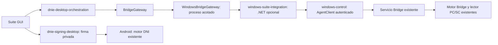

# H13 · Integración inicial modular Suite + Bridge

2026-10-07. Usuario autoriza iniciar unificación con módulos separados/distribuibles. Base `4cb944b`, checkpoint `checkpoint/pre-suite-bridge-h13` y fuente comprimida en `D:/DNIeToolchain/Checkpoints/pre-suite-bridge-h13/source.zip`. La base congelada y Antigravity no se modifican.

## Capas y alcance implementado

- `dnie-desktop-orchestration`: contratos neutrales de disponibilidad/estado/presencia y selección local de modo. No importa PDF, Swing, Android, APDU o servicio Windows. Un permiso de suite dura desde conexión hasta desconexión; su cierre es idempotente y un permiso antiguo no libera una conexión posterior.
- `WindowsBridgeGateway`: adaptador opcional con tres verbos fijos: status, open-manager y stop. ProcessBuilder sin shell, salida acotada256bytes y formato estricto DNIE1. No admite comandos arbitrarios, perfiles, PIN/CAN, material de emparejamiento o instrucciones APDU.
- `tools/windows-suite-integration`: ejecutable .NET que reutiliza AgentClient/SCM y la autenticación por PID del pipe existente. La salida contiene solo disponibilidad, estado del host y presencia del DNI; no reenvía perfiles, errores internos, QR o secretos. Solo `status` y `stop` van al servicio; abrir gestor usa la instalación protegida existente, comprueba propietario, versión bajo ruta conocida y ausencia de reparse points. No instala, repara, eleva, inicia el host ni detiene el servicio.
- `BridgePanel`: panel opcional en la GUI de suite; estado, actualización manual, apertura del gestor y parada explícita con confirmación. Todas las llamadas bloqueantes se ejecutan fuera de EDT. Cerrar la suite no detiene el puente ni el servicio.
- `SuiteController`: adquiere el permiso local antes de conectar, lo libera ante fallo/desconexión y conserva modo suite entre lotes. No modifica DesktopSuiteSession, el transporte privado, protocolo NFC, PIN, firmas, TSA, PC/SC ni la lógica interna del gestor.

La configuración Tailscale/LAN/USB, QR, instalación y selector continúan **en la ventana del gestor nativo existente**. Esta iteración integra coordinación y acceso funcional desde la suite; no incrusta WinForms dentro de Swing ni declara una UI completamente fusionada.

## Selección de modo

Si el adaptador está presente y el puente está activo, iniciando, deteniéndose, fallido o no verificable, se rechaza conectar suite hasta detener/revisar Bridge. No se detiene automáticamente una conexión de otras aplicaciones. Servicio ausente/detenido y módulo opcional ausente permiten la suite autónoma. Estados de transición del servicio se tratan como no disponibles.

Mientras la GUI mantiene permiso de suite, no abre el gestor ni ejecuta parada Bridge. La consulta de estado sigue permitida. La guardia es **local a esta instancia de GUI**: no controla un gestor que ya estaba abierto, otra instancia o la CLI autónoma. No constituye exclusión global entre procesos ni reemplaza el arbitraje del teléfono/servicio. Las identidades y autorizaciones de ambos productos permanecen separadas; no se comparten ni regeneran secretos.

## Distribuciones independientes

- Suite autónoma: compilar `:dnie-signing-ui:installDist` sin `bridgeIntegrationDir`; no incluye helper .NET, servicio o controlador. La biblioteca neutral de coordinación no exige .NET y el panel se omite cuando el helper no existe.
- Bridge autónomo: proyectos/gestor/servicio actuales, sin dependencia de JVM o suite; instalación previa intacta.
- Producto integrado: añadir `-PbridgeIntegrationDir=<directorio publicado del helper>` al `installDist` de GUI. Se copia solo el helper y dependencias a `tools/bridge-integration`. Necesita .NET8 instalado para el adaptador; conserva requisito Java17 de la suite.
- CLI de firma mantiene distribución y flujo autónomos; no obtiene guardia global por esta integración GUI.

Artefacto preparado: `D:/DNIeToolchain/Builds/suite-bridge-h13/ABRIR-SUITE-INTEGRADA.bat`. GUI bajo `signing-ui/install/dnie-signing-ui`, helper bajo `bridge-adapter`. Versiones H12 y Bridge instalado preservadas. APK63 recompilado sin cambios funcionales ni nueva versión: no necesita reinstalación.

## Pruebas

43 pruebas pasan: coordinación5, PDF desktop13, firma desktop23 y controlador GUI2. Incluyen rechazo de modo con puente activo/desconocido, ausencia opcional sin instalación, cambio de modo bloqueado durante permiso, cierre antiguo sin liberar permiso nuevo y rechazo de salida nativa inválida/con campos adicionales. El controlador GUI rechaza conexión con Bridge activo antes de abrir transporte Android y libera el permiso ante fallo de conexión. GUI y CLI compiladas, APK Debug compilado, .NET Release publicado sin advertencias finales. Log JVM `D:/DNIeToolchain/Temp/suite-bridge-h13-build.log` (57s), nativo `suite-bridge-h13-native.log`.

Smoke real **de solo consulta**: helper devuelve `AVAILABLE / STOPPED / card=false` desde el servicio instalado. Start y diagnostics rechazados (código2); no se prueban inicio/parada ni instalación. Smoke desde bibliotecas distribuidas JVM → helper → pipe autenticado del servicio: PASS; permiso de suite obtenido y apertura Bridge bloqueada mientras se mantiene, sin lanzar procesos del gestor ni modificar host. Evidencia `D:/DNIeToolchain/Temp/suite-bridge-h13-smoke.log`.

## Pendientes

Probar físicamente apertura del gestor desde GUI, detener un puente activo con confirmación, cambio Bridge↔Suite. La firma privada Windows con DNI y TSA H12 fue confirmada por el usuario para el PDF del lote PC01; CMS TXT separado también válido. Falta resultado del segundo PDF y confirmación explícita de completos3/3/PIN único. Próximas iteraciones: mover presentación/configuración Bridge a un frontend común vía contratos acotados, perfiles públicos compartidos sin mezclar identidades, notificaciones de conexión, catálogo de certificados/ICAO mediante adaptadores públicos y distribución/instalador opcional por producto. No cambiar motores comprobados para resolver duplicación visual.

Checkpoint final `checkpoint/suite-bridge-modular-h13`, fuente/manifiesto en `D:/DNIeToolchain/Checkpoints/suite-bridge-modular-h13`.

Distribución autónoma compilada y comprobada sin directorio bridge-integration: `D:/DNIeToolchain/Builds/suite-standalone-h13/signing-ui/install/dnie-signing-ui`. Log standalone correcto15s en `suite-bridge-h13-standalone.log`; el paquete integrado sí contiene el helper. Esta prueba confirma composición opcional, sin instalar o modificar Bridge.

## Repriorización del usuario

2026-10-07: lote validado también para el segundo PDF, cerrado por confirmación del usuario. La integración visual completa se difiere a3.0 junto al rediseño; distribución/instalador se difiere hasta pulir ambas plataformas. Cambio físico Bridge↔Suite sigue independiente de la prueba de firma. Recuperación TSA/preflight online automático y LT/LTA siguen pendientes, sin iniciar esas implementaciones en este ajuste.
